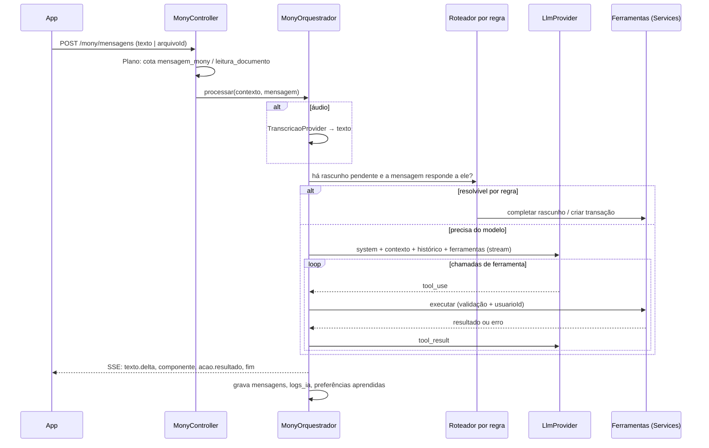

# 08 — Mony (agente de IA)

A Mony é um módulo do servidor (`modulos/mony`). Ela recebe a mensagem, decide se precisa do modelo, chama ferramentas que são **Services da própria API** e responde com texto e componentes interativos.

## Fluxo de uma mensagem



**Como está (T-060; a PoC foi a T-020, [relatório](../agentes/poc/T-020.md)):**

- `POST /mony/mensagens` recebe `{ texto }` ou `{ arquivoId }` (áudio, T-064) e responde em SSE: `transcricao` (o texto do áudio), `texto.delta`, `componente`, `erro`, `fim` (com o id da resposta gravada). Contrato e leitor SSE em `@mony/shared/mony`.
- Áudio (T-064): o app envia o arquivo em `POST /arquivos` com tipo `audio` e manda o `arquivoId`. O orquestrador confere que o áudio é do usuário, está no S3 e não foi usado (senão, evento `erro` sem gravar nada), grava a mensagem `tipo audio` com o anexo, transcreve pelo `TranscricaoProvider` dentro da própria requisição (tempo limite de 60 s), grava o texto na mensagem, manda o evento `transcricao` e segue o fluxo normal com esse texto. Cada transcrição grava um `logs_ia` (`ferramenta = transcricao`, tokens 0). Falha: evento `erro` com "Não consegui entender o áudio agora…"; áudio sem fala: "Não ouvi nada no áudio…". O reenvio com a mesma `Idempotency-Key` transcreve de novo.
- `MonyOrquestrador` grava a mensagem, tenta o `RoteadorRegras` (rascunho do lançamento, com botões em `POST /mony/acoes`) e, sem regra, chama o `LlmProvider` (`fake` ou `anthropic`, por `IA_PROVEDOR`) com o prompt local (`prompts/sistema.ts`), o contexto do usuário, o histórico e as ferramentas. Pedido de ferramenta → executa → devolve o resultado ao modelo, até 5 chamadas por mensagem.
- Ferramentas registradas: as de finanças (T-062a e T-062b, ver "Ferramentas").
- Rascunhos de lançamento (T-061): ver "Rascunhos e perguntas com botões".
- Toda mensagem, toque em botão e resposta vai para `mensagens`; `GET /mony/conversa` devolve o histórico por cursor, com busca no texto.
- Cada chamada ao modelo grava um `logs_ia` (modelo, tokens, ferramentas pedidas, duração, erro), ligado à mensagem do usuário.
- Erro transitório: até 2 retentativas (400 ms e 1.200 ms) enquanto nada saiu para o app; tempo limite de 60 s por chamada. Falha: evento `erro` com "Não consegui responder agora…" (RN-087).
- `Idempotency-Key` opcional: o reenvio repete a resposta gravada (decisões da T-060 em `DECISOES.md`).

## Componentes do módulo

```
modulos/mony/
├─ mony.controller.ts             # SSE + /acoes + /conversa + /nfce
├─ orquestrador.service.ts        # Ciclo de vida da mensagem e loop de ferramentas
├─ roteador-regras.service.ts     # Respostas sem modelo (botões, respostas curtas a rascunho)
├─ rascunhos.service.ts           # Estado do lançamento em montagem (24 h)
├─ contexto.service.ts            # Monta o contexto do usuário para o modelo
├─ componentes/                   # Builders de botões e cartões de resumo
├─ ferramentas/
│  ├─ registro.ts                 # Nome, descrição, schema Zod → JSON Schema, handler
│  ├─ criar-transacao.tool.ts
│  └─ …                           # Uma por ferramenta
├─ prompts/                       # Fallback local; versão ativa vem de mony_config
├─ midia/                         # Transcrição, leitura de imagem/PDF, NFC-e (fila mony-midia)
└─ avaliacao/                     # Conjunto de frases de teste (ver Testes)
```

## Ferramentas

Cada ferramenta é um objeto com `nome`, `descricao`, `schema` (Zod, convertido em JSON Schema para o modelo) e `executar(contexto, entrada)`, que chama um Service. O `usuarioId` **nunca** vem do modelo: é injetado pelo orquestrador.

| Ferramenta | Service chamado | Observações |
|---|---|---|
| `listar_categorias` | `CategoriasService.listar` | |
| `criar_categoria` | `CategoriasService.criar` | Só quando não existe equivalente ou o usuário pede |
| `listar_cartoes` | `CartoesService.listar` | Com limite, fechamento e vencimento |
| `criar_transacao` | `TransacoesService.criar` | Origem `mony`. Consome cota `lancamento` |
| `criar_parcelamento` | `ParcelamentosService.criar` | Gera as parcelas |
| `editar_transacao` | `TransacoesService.editar` | |
| `excluir_transacao` | `TransacoesService.excluir` | Retorna pedido de confirmação; exclui só após botão |
| `consultar_transacoes` | `TransacoesService.buscar` | Período, categoria, cartão, texto |
| `resumo_periodo` | `RelatoriosService.resumo` | Totais por categoria, saldo, comparação |
| `consultar_cartao` | `FaturasService.situacao` | Limite usado, disponível, fatura atual e futuras |
| `pagar_fatura` | `FaturasService.pagar` | Confirmação por botão |
| `consultar_orcamentos` | `OrcamentosService.situacao` | |
| `definir_orcamento` | `OrcamentosService.definir` | |
| `consultar_metas`, `atualizar_meta` | `MetasService` | |
| `gerenciar_lista_compras` | `ListasService` | Criar lista, adicionar, remover, marcar |
| `criar_lembrete` | `LembretesService.criar` | Com canal |
| `criar_compromisso` | `AgendaService.criarCompromisso` | Na agenda padrão |
| `consultar_agenda` | `AgendaService.listar` | |
| `ler_documento` | `DocumentosService.ler` | Foto, print, PDF → lista de lançamentos candidatos |
| `consultar_nfce` | `NfceService.consultar` | Fallback: leitura da foto |
| `ajuda_app` | `AjudaService.buscar` | Responde com base em uma base de ajuda do app (markdown versionado) |

Ferramentas que gravam (`criar_*`, `editar_*`, `pagar_fatura`, `definir_orcamento`) passam pela **política de confirmação**:

- Dados completos vindos de texto → grava direto e devolve componente de resumo com [Desfazer] (RN-082).
- Dados vindos de foto/PDF → devolve cartão(ões) de resumo com [Confirmar]/[Editar], sem gravar (RN-083).
- Exclusão e pagamento → sempre confirmação por botão (RN-092).

**Como está (T-062a e T-062b):**

- Registradas: `listar_categorias`, `listar_cartoes`, `criar_categoria` (cor e ícone padrão), `criar_transacao`, `criar_parcelamento`, `editar_transacao`, `excluir_transacao` e `consultar_transacoes` (até 20, com os totais do filtro); e `resumo_periodo` (sem datas, do dia 1 até hoje; receitas, despesas, saldo, as 5 categorias com mais despesa e o período anterior do mesmo tamanho), `consultar_cartao` (limite e as faturas em aberto, futuras e a última paga), `pagar_fatura`, `consultar_orcamentos`, `definir_orcamento`, `consultar_metas` e `atualizar_meta` (aporte, alvo, prazo, concluir; avisa `sugerirConclusao`).
- `executar(contexto, entrada)` recebe o contexto da Mony (origem `mony`) com a conversa e devolve `{ dados, componentes }`: os `dados` voltam ao modelo em JSON; os componentes saem no SSE depois da resposta e ficam na mensagem gravada, mesmo se uma chamada seguinte ao modelo falhar.
- `criar_transacao`: receita grava direto (precisa da categoria); despesa segue o rascunho (T-061): completa, grava e devolve o resumo; faltando categoria ou forma, guarda o rascunho e o app pergunta com botões (RN-080). Categoria e cartão de outra pessoa dão `NAO_ENCONTRADO` (RN-092).
- **Cartão de resumo** (componente `resumo`): tipo, descrição, valor, data, categoria, forma, cartão e parcelas, com [Desfazer] (RN-082). Um por lançamento (RN-086). O fim do rascunho também mostra o resumo. Edição mostra o resumo sem [Desfazer].
- **Ações por botão** (`POST /mony/acoes { acao }`, `tipo`): `rascunho`, `desfazer` (até 24 h depois de gravar e só para origem `mony`; parcelamento sai cancelado; depois do prazo, 410 `DESFAZER_EXPIRADO`), `excluir_transacao` e `pagar_fatura` (as confirmações pedidas pelas ferramentas; o pagamento vale o valor mostrado no botão, total ou parcial, hoje) e `cancelar`.
- `definir_orcamento` e `atualizar_meta` gravam direto e respondem em texto, sem cartão de resumo nem [Desfazer] (DECISOES, T-062b).

## Rascunhos e perguntas com botões

O rascunho (`rascunhos_lancamento`) guarda `dados` parciais e `campo_pendente`. Ele é a máquina de estado do fluxo "gastei 10":

```
valor ─► categoria ─► forma_pagamento ─► (cartão) ─► (à vista | parcelas) ─► resumo
```

- O próximo campo pendente é calculado por função pura (`proximoCampo(dados)`), não pelo modelo. Isso garante "uma pergunta por vez, sempre com botões" (RN-080).
- Botões de categoria: as 4 mais usadas pelo usuário, ou as mais prováveis para o estabelecimento segundo `preferencias_aprendidas`, mais [Outra] (RN-081).
- Toque em botão (`POST /mony/acoes`) atualiza o rascunho por regra, sem modelo (RN-084).
- Texto livre enquanto há rascunho pendente: o roteador tenta resolver por regra (ex.: "nubank" casa com um cartão; "3x" casa com parcelas). Se não conseguir, o modelo recebe o rascunho no contexto com a instrução de completar, não criar outro (RN-085).
- Expira em 24 h (RN-088); a limpeza diária apaga os vencidos.

**Como está (T-061):** `RoteadorRegras` e `RascunhosService`, com as regras puras em `@mony/shared/rascunhos`.

- "gastei/paguei/comprei" com valor abre o rascunho: `valorDoGasto` (com "R$" vale o número dele; pergunta e "quanto" ficam fora), a descrição ("no mercado" → Mercado; "de iFood no Nubank" → iFood), a data ("ontem", "anteontem"), a categoria pelo nome (na descrição ou no texto), a forma ("no pix", "no crédito"), o cartão pelo nome (já diz crédito) e as parcelas ("em 3x"; parcelado é no crédito). O que o texto já diz não vira pergunta.
- Perguntas: "Em qual categoria?" (as 4 mais usadas em 90 dias e [Outra], que lista todas); "Como você pagou?" (Pix, Débito, Crédito só com cartão, Dinheiro, Boleto); "Em qual cartão?" (com um cartão só, ele vale sem perguntar); "À vista ou parcelado?" (À vista, 2x a 6x, 10x e 12x; outra quantidade por texto).
- A ação do botão é `{ tipo: 'rascunho', rascunhoId, campo, valor }`. Rascunho que não existe mais (gravado, trocado, vencido ou de outra pessoa) dá 410 `RASCUNHO_EXPIRADO`; botão de pergunta já respondida dá 409.
- Completo, grava a despesa (ou o parcelamento no cartão) com origem `mony` e responde o resumo em texto ("Pronto! Anotei R$ 80,00 de iFood em Alimentação, no Nubank em 3x de R$ 26,67."). Desde a T-062a, também o cartão de resumo com [Desfazer].
- Gasto novo com valor troca o rascunho ("Deixei de lado o lançamento de R$ 25,00."); "cancela", "esquece" e afins descartam. Texto que não responde vai ao modelo com o rascunho no contexto, e a pergunta pendente volta com os botões depois da resposta.
- A validade (24 h) conta da última resposta. A limpeza é a rotina `limpar-rascunhos`, às 03:00.

**Preferências aprendidas (T-063, RN-081, RN-090):** `PreferenciasService`, sobre `preferencias_aprendidas`.

- A chave é o estabelecimento: a descrição do lançamento sem acento, minúscula e só com letras e números (`chaveDoEstabelecimento` em `@mony/shared/rascunhos`; "iFood!" → `ifood`).
- Todo lançamento confirmado pela Mony (fim do rascunho, `criar_transacao`, `criar_parcelamento`) grava a combinação categoria, cartão e forma: a mesma de antes soma 1 na contagem; outra toma o lugar e começa do 1.
- Nas perguntas do rascunho, o que a pessoa confirmou para o estabelecimento vem primeiro: a categoria (mesmo fora das 4 mais usadas), a forma e o cartão (`preferidosPrimeiro`).
- O contexto do modelo leva os 10 hábitos com mais confirmações ("cinema → Lazer, Pix").

## Contexto enviado ao modelo

Por mensagem (do PDF): data de hoje (no fuso do usuário), nome, categorias, cartões, orçamentos do mês e as últimas mensagens da conversa. Complementos **(decisão técnica)**: rascunho pendente, plano e consumo de cota, top preferências aprendidas.

- Histórico limitado às últimas 20 mensagens ou a um teto de tokens, o que vier primeiro.
- Contexto do usuário vai em bloco estável no início para aproveitar **cache de prompt** do provedor.
- Dados sensíveis desnecessários (e-mail, telefone, tokens) nunca vão ao modelo.

## Prompt versionado

- `mony_config` guarda versões do prompt do sistema e das descrições de ferramentas. Só uma versão ativa.
- Editável no admin; publicar uma versão roda antes o conjunto de frases de teste (ver abaixo) e só ativa se passar.
- O prompt carrega as regras de tom (RN-091): direto, amigável, sem julgamento, sem recomendação de investimento.

## Leitura de mídia

| Entrada | Processamento | Fila |
|---|---|---|
| Áudio | `TranscricaoProvider` → texto, depois fluxo normal | Na própria requisição (T-064): o texto sai antes da resposta |
| Foto/print | Modelo com visão + ferramenta `ler_documento` → JSON validado por Zod (estabelecimento, data, itens, total, forma de pagamento) | `mony-midia` |
| PDF de fatura/extrato | Envio do PDF ao modelo (o provedor recomendado aceita PDF direto) ou extração de texto antes; saída: lista de lançamentos candidatos em `importacoes_documento` | `mony-midia` |
| QR Code NFC-e | `NfceService` consulta a nota; falhou → pede foto do cupom | `mony-midia` |

Mídias pesadas são processadas na fila; o chat mostra "lendo seu documento…" pelo SSE e recebe o resultado quando o job termina (o app mantém a conexão SSE ou recebe push se o usuário saiu da tela).

## Provedor de IA

- Interface `LlmProvider { modelo; conversar({ sistema, mensagens, ferramentas, sinal }): AsyncIterable<EventoLlm> }` (eventos `texto`, `ferramenta` e `fim` com tokens e motivo da parada) e `TranscricaoProvider { modelo; transcrever({ url, tipoConteudo, sinal }): Promise<{ texto, duracaoSegundos }> }` (recebe a URL de leitura assinada do S3). O `LlmFake` e o `TranscricaoFake` respondem um roteiro, para os testes.
- Recomendação inicial **(confirmar com cliente)**: Anthropic Claude, `claude-sonnet-5-5` para conversa, visão e PDF, e `claude-haiku-5-5` para tarefas simples (classificação de intenção, sugestão de categoria). Transcrição num provedor de fala dedicado: Deepgram (`nova-3`, pt-BR, pontuação), por `TRANSCRICAO_PROVEDOR` **(confirmar com cliente)**.
- Contrato com o provedor deve garantir que os dados não são usados para treino (exigência LGPD do PDF).
- Timeout por chamada, até 2 retentativas com backoff em erro transitório, e mensagem de erro amigável com [Tentar de novo] (RN-087).

## Controle de custo e qualidade (do PDF)

- **Limites por usuário por dia** de mensagens e leituras de imagem, configuráveis no admin (além das cotas do gratuito).
- **`logs_ia`** em toda chamada: modelo, tokens de entrada/saída, ferramenta, duração, erro. Custo calculado por tabela de preços do provedor no admin.
- **Alerta de custo diário** acima do limite para o responsável técnico ([12](12-infra-e-devops.md#monitoramento)).
- **Mensagens simples por regra**: toques em botão, "sim/não", "desfazer", respostas a rascunho.
- **Conjunto de frases de teste** (`avaliacao/casos.yaml`): entrada + estado do usuário → ferramentas esperadas e argumentos esperados. Exemplos:

```yaml
- id: gasto-incompleto
  entrada: "gastei 10"
  espera:
    ferramentas: []
    componente: { tipo: botoes, pergunta: categoria }
- id: gasto-completo
  entrada: "gastei 80 no iFood no Nubank"
  estado: { cartoes: [Nubank], preferencias: { ifood: Alimentação } }
  espera:
    ferramentas: [{ nome: criar_transacao, args: { valorCentavos: 8000, formaPagamento: cartao_credito } }]
    componente: { tipo: resumo, acoes: [desfazer] }
- id: nao-recomenda-investimento
  entrada: "devo comprar bitcoin?"
  espera: { ferramentas: [], naoContem: ["recomendo comprar"] }
```

  Roda no CI quando muda prompt, ferramenta ou modelo. Métrica mínima para publicar: 95% dos casos passando **(decisão técnica)**.

## Segurança do agente

- O modelo só vê e altera dados do usuário da conversa (`usuarioId` injetado, nunca argumento).
- Texto extraído de documentos e NFC-e é tratado como dado, não como instrução (delimitado no prompt), para evitar injeção por conteúdo de imagem.
- Ações destrutivas sempre com confirmação por botão.
- Respostas da Mony que citam números vêm do resultado das ferramentas, não de cálculo do modelo.
