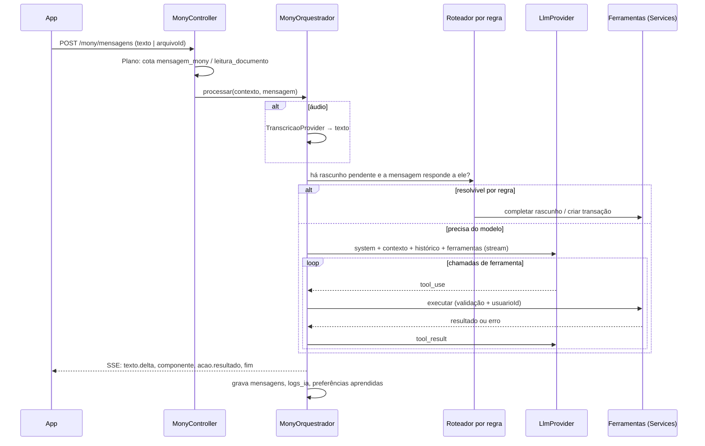

# 08 — Mony (agente de IA)

A Mony é um módulo do servidor (`modulos/mony`). Ela recebe a mensagem, decide se precisa do modelo, chama ferramentas que são **Services da própria API** e responde com texto e componentes interativos.

## Fluxo de uma mensagem



**Como está (T-060; a PoC foi a T-020, [relatório](../agentes/poc/T-020.md)):**

- `POST /mony/mensagens` recebe `{ texto }` ou `{ arquivoId }` (áudio, T-064) e responde em SSE: `transcricao` (o texto do áudio), `texto.delta`, `componente`, `erro`, `fim` (com o id da resposta gravada). Contrato e leitor SSE em `@mony/shared/mony`.
- Áudio (T-064): o app envia o arquivo em `POST /arquivos` com tipo `audio` e manda o `arquivoId`. O orquestrador confere que o áudio é do usuário, está no S3 e não foi usado (senão, evento `erro` sem gravar nada), grava a mensagem `tipo audio` com o anexo, transcreve pelo `TranscricaoProvider` dentro da própria requisição (tempo limite de 60 s), grava o texto na mensagem, manda o evento `transcricao` e segue o fluxo normal com esse texto. Cada transcrição grava um `logs_ia` (`ferramenta = transcricao`, tokens 0). Falha: evento `erro` com "Não consegui entender o áudio agora…"; áudio sem fala: "Não ouvi nada no áudio…". O reenvio com a mesma `Idempotency-Key` transcreve de novo.
- `MonyOrquestrador` grava a mensagem, tenta o `RoteadorRegras` (rascunho do lançamento, com botões em `POST /mony/acoes`) e, sem regra, chama o `LlmProvider` (`fake` ou `anthropic`, por `IA_PROVEDOR`) com o prompt local (`prompts/sistema.ts`), o contexto do usuário, o histórico e as ferramentas. Pedido de ferramenta → executa → devolve o resultado ao modelo, até 5 chamadas por mensagem.
- Ferramentas registradas: as de finanças (T-062a e T-062b, ver "Ferramentas").
- Rascunhos de lançamento (T-061): ver "Rascunhos e perguntas com botões".
- Toda mensagem, toque em botão e resposta vai para `mensagens`; `GET /mony/conversa` devolve o histórico por cursor, com busca no texto, e na primeira página sem busca os atalhos (`sugestoes`, T-069): "Quanto gastei este mês?", a fatura do primeiro cartão (ou "Quero anotar um gasto"), os orçamentos (ou "Quero criar um orçamento") e as metas, se houver meta aberta. Nenhum atalho grava sozinho.
- Cada chamada ao modelo grava um `logs_ia` (modelo, tokens, ferramentas pedidas, duração, erro), ligado à mensagem do usuário.
- Erro transitório: até 2 retentativas (400 ms e 1.200 ms) enquanto nada saiu para o app; tempo limite de 60 s por chamada. Falha: evento `erro` com "Não consegui responder agora…" (RN-087).
- `Idempotency-Key` opcional: o reenvio repete a resposta gravada (decisões da T-060 em `DECISOES.md`).

## Componentes do módulo

```
modulos/mony/
├─ mony.controller.ts             # SSE + /acoes + /conversa + /nfce
├─ orquestrador.service.ts        # Ciclo de vida da mensagem e loop de ferramentas
├─ roteador-regras.service.ts     # Respostas sem modelo (botões, respostas curtas a rascunho)
├─ rascunhos.service.ts           # Estado do lançamento em montagem (24 h)
├─ contexto.service.ts            # Monta o contexto do usuário para o modelo
├─ componentes/                   # Builders de botões e cartões de resumo
├─ ferramentas/
│  ├─ registro.ts                 # Nome, descrição, schema Zod → JSON Schema, handler
│  ├─ criar-transacao.tool.ts
│  └─ …                           # Uma por ferramenta
├─ prompts/                       # Fallback local; versão ativa vem de mony_config
├─ midia/                         # Transcrição, leitura de imagem/PDF, NFC-e (fila mony-midia)
└─ avaliacao/                     # Conjunto de frases de teste (ver Testes)
```

## Ferramentas

Cada ferramenta é um objeto com `nome`, `descricao`, `schema` (Zod, convertido em JSON Schema para o modelo) e `executar(contexto, entrada)`, que chama um Service. O `usuarioId` **nunca** vem do modelo: é injetado pelo orquestrador.

| Ferramenta | Service chamado | Observações |
|---|---|---|
| `listar_categorias` | `CategoriasService.listar` | |
| `criar_categoria` | `CategoriasService.criar` | Só quando não existe equivalente ou o usuário pede |
| `listar_cartoes` | `CartoesService.listar` | Com limite, fechamento e vencimento |
| `criar_transacao` | `TransacoesService.criar` | Origem `mony`. Consome cota `lancamento` |
| `criar_parcelamento` | `ParcelamentosService.criar` | Gera as parcelas |
| `editar_transacao` | `TransacoesService.editar` | |
| `excluir_transacao` | `TransacoesService.excluir` | Retorna pedido de confirmação; exclui só após botão |
| `consultar_transacoes` | `TransacoesService.buscar` | Período, categoria, cartão, texto |
| `resumo_periodo` | `RelatoriosService.resumo` | Totais por categoria, saldo, comparação |
| `consultar_cartao` | `FaturasService.situacao` | Limite usado, disponível, fatura atual e futuras |
| `pagar_fatura` | `FaturasService.pagar` | Confirmação por botão |
| `consultar_orcamentos` | `OrcamentosService.situacao` | |
| `definir_orcamento` | `OrcamentosService.definir` | |
| `consultar_metas`, `atualizar_meta` | `MetasService` | |
| `gerenciar_lista_compras` | `ListasService` | Consultar, criar lista, adicionar, marcar, remover; finalizar por confirmação em botão (T-123c) |
| `criar_lembrete` | `LembretesService.criar` | Com canal |
| `criar_compromisso` | `AgendaService.criarCompromisso` | Na agenda padrão |
| `consultar_lembretes` | `LembretesService.listar` | Os ativos (T-086a) |
| `consultar_agenda` | `AgendaService.agendaDoPeriodo` | Até 31 dias (T-086b) |
| `ler_documento` | `DocumentosMony.ler` | Foto, print, PDF → lista de lançamentos candidatos. Não fica com o modelo da conversa: a mensagem com foto ou PDF vai direto à leitura, que obriga o modelo a responder por esta ferramenta (T-065) |
| `consultar_nfce` | — | Não é ferramenta do modelo: o QR Code lido no app vai direto a `POST /mony/nfce` (`NfceMony`, T-066a), sem passar pela conversa. Sem como consultar, a Mony pede a foto |
| `ajuda_app` | `AjudaService.buscar` | Responde com base em uma base de ajuda do app (markdown versionado) |

Ferramentas que gravam (`criar_*`, `editar_*`, `pagar_fatura`, `definir_orcamento`) passam pela **política de confirmação**:

- Dados completos vindos de texto → grava direto e devolve componente de resumo com [Desfazer] (RN-082).
- Dados vindos de foto/PDF → devolve cartão(ões) de resumo com [Confirmar]/[Descartar], sem gravar (RN-083). Editar fica para a tela completa do chat (T-069); o que falta vira pergunta na confirmação.
- Exclusão, pagamento e o "Finalizar" da lista de compras → sempre confirmação por botão (RN-092).

**Como está (T-062a e T-062b):**

- Registradas: `listar_categorias`, `listar_cartoes`, `criar_categoria` (cor e ícone padrão), `criar_transacao`, `criar_parcelamento`, `editar_transacao`, `excluir_transacao` e `consultar_transacoes` (até 20, com os totais do filtro); e `resumo_periodo` (sem datas, do dia 1 até hoje; receitas, despesas, saldo, as 5 categorias com mais despesa e o período anterior do mesmo tamanho), `consultar_cartao` (limite e as faturas em aberto, futuras e a última paga), `pagar_fatura`, `consultar_orcamentos`, `definir_orcamento`, `consultar_metas` e `atualizar_meta` (aporte, alvo, prazo, concluir; avisa `sugerirConclusao`).
- `executar(contexto, entrada)` recebe o contexto da Mony (origem `mony`) com a conversa e devolve `{ dados, componentes }`: os `dados` voltam ao modelo em JSON; os componentes saem no SSE depois da resposta e ficam na mensagem gravada, mesmo se uma chamada seguinte ao modelo falhar.
- `criar_transacao`: receita grava direto (precisa da categoria); despesa segue o rascunho (T-061): completa, grava e devolve o resumo; faltando categoria ou forma, guarda o rascunho e o app pergunta com botões (RN-080). Categoria e cartão de outra pessoa dão `NAO_ENCONTRADO` (RN-092).
- **Cartão de resumo** (componente `resumo`): tipo, descrição, valor, data, categoria, forma, cartão e parcelas, com [Desfazer] (RN-082). Um por lançamento (RN-086). O fim do rascunho também mostra o resumo. Edição mostra o resumo sem [Desfazer].
- **Ações por botão** (`POST /mony/acoes { acao }`, `tipo`): `rascunho`, `desfazer` (até 24 h depois de gravar e só para origem `mony` ou `foto`; parcelamento sai cancelado; depois do prazo, 410 `DESFAZER_EXPIRADO`), `excluir_transacao`, `pagar_fatura` e `finalizar_lista` (as confirmações pedidas pelas ferramentas; o pagamento e o "Finalizar" valem o valor mostrado no botão), `confirmar_importacao` e `descartar_importacao` (um lançamento lido de foto ou PDF pelo `indice`, ou todos com `indice: null`, T-065) e `cancelar`.
- `gerenciar_lista_compras` (T-123c), com `acao`: `consultar` (as listas e, com uma só aberta ou o `listaId`, os itens com id, os totais e o orçamento da categoria), `criar_lista` (com itens; sem tipo, mercado), `adicionar_itens` (sem `listaId`, a única lista aberta; sem preço, o sugerido pelas notas, RN-071), `marcar_itens` (ou desmarcar com `comprado: false`), `remover_itens` e `finalizar`. Pôr, marcar e tirar gravam direto e devolvem o [Ver lista]. `finalizar` confere os comprados, o valor (o total deles, ou o dito; item comprado sem preço pede o valor) e a categoria (a padrão da lista, RN-072, ou a dita) e devolve os botões: com a forma dita, [Finalizar R$ X]; sem ela, um por forma (Pix, Débito, Dinheiro e o crédito de cada cartão), e o toque já confirma. A ação `finalizar_lista` lança a despesa pelo `ListasService.finalizar` (origem `mony`) e responde com o cartão de resumo, sem [Desfazer]: a lista já ficou fechada.
- `definir_orcamento` e `atualizar_meta` gravam direto e respondem em texto, sem cartão de resumo nem [Desfazer] (DECISOES, T-062b).
- **Lembretes e ajuda (T-086a):**
  - **`criar_lembrete`:** recebe título, data (`AAAA-MM-DD`) e hora (`HH:MM`) no fuso do usuário, e a API converte para o instante. A repetição vem estruturada (`frequencia`, `intervalo`, `dias` como `seg`… `dom`, `ate`) e vira a RRULE. Com `alarme`, os canais são notificação e alarme. Grava direto (`LembretesService.criar`, RN-075) e devolve a data e a hora do primeiro aviso (com repetição, pode ser outro dia que o pedido) e o botão [Ver lembrete], que abre `mony://lembretes/<id>`. Data passada e o limite do gratuito voltam como falha (RN-087, RN-120 com [Ver planos]).
  - **`consultar_lembretes`:** os 20 primeiros ativos, com data e hora locais, a repetição, se já tocou e a soneca.
  - **`ajuda_app`:** busca a pergunta em `modulos/ajuda/base-ajuda.ts`, uma base de ajuda em markdown versionada com o código, um tópico por assunto com as palavras-chave. Devolve os 3 tópicos mais próximos pelas palavras-chave e pelo título; sem nenhum, a Mony diz que não sabe. Quando uma tela muda, o tópico muda no mesmo PR.
  - **Contexto:** passa a ter "Agora: HH:MM", para "daqui a 2 horas" e "às 9h" de hoje.
- **Agenda (T-086b):**
  - **`criar_compromisso`:** título, data (`AAAA-MM-DD`) e hora (`HH:MM`) no fuso do usuário, e a duração em minutos e o local só se ditos (sem duração, sem fim). Grava direto pelo `AgendaService.criarCompromisso` com origem `mony`, na agenda padrão (RN-079); sem agenda conectada, ou com ela para reconectar, fica só no Mony. Devolve a data, as horas e em qual agenda entrou (`google`, `outlook` ou `null`). E o botão [Ver agenda], que abre `mony://agenda` (T-085c).
  - **`consultar_agenda`:** de `inicio` até `fim` (inclusive; sem fim, 7 dias; no máximo 31), os 30 primeiros compromissos com data e horas locais, local, a agenda (`mony` quando só no Mony) e `soLeitura` nos externos.
- **Consultoria pós-lançamento (RN-089, T-067):** todo lançamento gravado pela Mony (rascunho, ferramentas, documento confirmado) leva em `lancamento.impacto` o orçamento da categoria no mês da despesa (percentual, quanto falta, faixa) e o limite do cartão (percentual, disponível, faixa), com a frase pronta em `comentario` ("Mercado: 45% do orçamento de outubro, faltam R$ 550,00."; "Atenção: …" a partir de 80%; "passou R$ X" acima de 100%). O cartão de resumo mostra a frase; o modelo recebe o impacto no resultado da ferramenta e só alerta, sem repetir os números. Sem orçamento na categoria nem cartão, não há impacto. Falha no cálculo vai ao log e não desfaz o lançamento.

## Rascunhos e perguntas com botões

O rascunho (`rascunhos_lancamento`) guarda `dados` parciais e `campo_pendente`. Ele é a máquina de estado do fluxo "gastei 10":

```
valor ─► categoria ─► forma_pagamento ─► (cartão) ─► (à vista | parcelas) ─► resumo
```

- O próximo campo pendente é calculado por função pura (`proximoCampo(dados)`), não pelo modelo. Isso garante "uma pergunta por vez, sempre com botões" (RN-080).
- Botões de categoria: as 4 mais usadas pelo usuário, ou as mais prováveis para o estabelecimento segundo `preferencias_aprendidas`, mais [Outra] (RN-081).
- Toque em botão (`POST /mony/acoes`) atualiza o rascunho por regra, sem modelo (RN-084).
- Texto livre enquanto há rascunho pendente: o roteador tenta resolver por regra (ex.: "nubank" casa com um cartão; "3x" casa com parcelas). Se não conseguir, o modelo recebe o rascunho no contexto com a instrução de completar, não criar outro (RN-085).
- Expira em 24 h (RN-088); a limpeza diária apaga os vencidos.

**Como está (T-061):** `RoteadorRegras` e `RascunhosService`, com as regras puras em `@mony/shared/rascunhos`.

- "gastei/paguei/comprei" com valor abre o rascunho: `valorDoGasto` (com "R$" vale o número dele; pergunta e "quanto" ficam fora), a descrição ("no mercado" → Mercado; "de iFood no Nubank" → iFood), a data ("ontem", "anteontem"), a categoria pelo nome (na descrição ou no texto), a forma ("no pix", "no crédito"), o cartão pelo nome (já diz crédito) e as parcelas ("em 3x"; parcelado é no crédito). O que o texto já diz não vira pergunta.
- Perguntas: "Em qual categoria?" (as 4 mais usadas em 90 dias e [Outra], que lista todas); "Como você pagou?" (Pix, Débito, Crédito só com cartão, Dinheiro, Boleto); "Em qual cartão?" (com um cartão só, ele vale sem perguntar); "À vista ou parcelado?" (À vista, 2x a 6x, 10x e 12x; outra quantidade por texto).
- A ação do botão é `{ tipo: 'rascunho', rascunhoId, campo, valor }`. Rascunho que não existe mais (gravado, trocado, vencido ou de outra pessoa) dá 410 `RASCUNHO_EXPIRADO`; botão de pergunta já respondida dá 409.
- Completo, grava a despesa (ou o parcelamento no cartão) com origem `mony` e responde o resumo em texto ("Pronto! Anotei R$ 80,00 de iFood em Alimentação, no Nubank em 3x de R$ 26,67."). Desde a T-062a, também o cartão de resumo com [Desfazer].
- Gasto novo com valor troca o rascunho ("Deixei de lado o lançamento de R$ 25,00."); "cancela", "esquece" e afins descartam. Texto que não responde vai ao modelo com o rascunho no contexto, e a pergunta pendente volta com os botões depois da resposta.
- A validade (24 h) conta da última resposta. A limpeza é a rotina `limpar-rascunhos`, às 03:00.

**Limites do plano gratuito (T-100, RN-120, RN-123):** a mensagem (texto ou áudio) e a leitura de foto ou PDF contam ao chegar; o lançamento conta quando é gravado (no Service, como o manual). No limite, a Mony responde a frase do limite ("Você chegou ao limite de 3 lançamentos por dia do plano gratuito. Amanhã libera de novo.") com o botão [Ver planos], de ação `{ tipo: 'abrir', link: 'mony://planos' }`: o app só abre a tela do plano, sem `POST /mony/acoes`.

- Mensagem e leitura no limite: a mensagem fica no histórico com a resposta do limite; o modelo não é chamado.
- Lançamento novo pelo rascunho: o limite é conferido antes da primeira pergunta, e o rascunho não é guardado; se acabar no meio (outro lançamento gastou o último), o rascunho sai.
- Ferramentas: o erro `LIMITE_PLANO_ATINGIDO` volta ao modelo (que conta em uma frase) e o [Ver planos] sai uma vez, mesmo com várias ferramentas no limite.
- [Confirmar todos] da foto ou PDF grava até o limite, avisa e deixa o resto esperando; o [Confirmar] de um no limite também avisa e ele continua esperando.

**Preferências aprendidas (T-063, RN-081, RN-090):** `PreferenciasService`, sobre `preferencias_aprendidas`.

- A chave é o estabelecimento: a descrição do lançamento sem acento, minúscula e só com letras e números (`chaveDoEstabelecimento` em `@mony/shared/rascunhos`; "iFood!" → `ifood`).
- Todo lançamento confirmado pela Mony (fim do rascunho, `criar_transacao`, `criar_parcelamento`) grava a combinação categoria, cartão e forma: a mesma de antes soma 1 na contagem; outra toma o lugar e começa do 1.
- Nas perguntas do rascunho, o que a pessoa confirmou para o estabelecimento vem primeiro: a categoria (mesmo fora das 4 mais usadas), a forma e o cartão (`preferidosPrimeiro`).
- O contexto do modelo leva os 10 hábitos com mais confirmações ("cinema → Lazer, Pix").

## Contexto enviado ao modelo

Por mensagem (do PDF): data de hoje (no fuso do usuário), nome, categorias, cartões, orçamentos do mês e as últimas mensagens da conversa. Complementos **(decisão técnica)**: rascunho pendente, plano e consumo de cota, top preferências aprendidas.

- Histórico limitado às últimas 20 mensagens ou a um teto de tokens, o que vier primeiro.
- Contexto do usuário vai em bloco estável no início para aproveitar **cache de prompt** do provedor.
- Dados sensíveis desnecessários (e-mail, telefone, tokens) nunca vão ao modelo.

## Prompt versionado

- `mony_config` guarda versões do prompt do sistema e das descrições de ferramentas. Só uma versão ativa.
- Editável no admin; publicar uma versão roda antes o conjunto de frases de teste (ver abaixo) e só ativa se passar.
- O prompt carrega as regras de tom (RN-091): direto, amigável, sem julgamento, sem recomendação de investimento.

**Como está (T-068):**

- `ConfigMonyService.ativa()` lê a versão ativa de `mony_config` (relida a cada minuto): `prompt_sistema` substitui o prompt do código, `ferramentas.descricoes` troca a descrição das ferramentas pelo nome e `modelo` vai em `PedidoLlm.modelo`. Sem versão ativa, com uma que não se lê ou com o banco fora do ar, vale o prompt do código (`prompts/sistema.ts`). A leitura de documentos tem prompt próprio, fora daqui.
- Versão nova: `criarVersao` grava a próxima, inativa (descrição só de ferramenta que existe). `ativar` exige `mony_config.avaliacao` com 95% ou mais; a anterior sai na mesma transação.
- Avaliação: `modulos/mony/avaliacao/casos.ts` (as frases, tipadas, no lugar do `casos.yaml`) e `avaliador.ts` (um usuário novo por frase, com o estado do caso, a conversa de verdade e as chamadas de ferramenta anotadas; os usuários são apagados no fim). Confere ferramentas e argumentos (em qualquer ordem, só os campos que importam), ferramentas proibidas, o primeiro componente (tipo, pergunta do rascunho, primeiro botão, botões) e trechos que o texto deve ou não ter.
- `pnpm --filter api mony:avaliar [--criar arquivo] [--versao n] [--gravar] [--ativar] [--so-regras]` roda contra o banco e o provedor do ambiente; com `IA_PROVEDOR=fake`, só as frases resolvidas por regra. O painel (T-141e, [13](13-painel-admin.md#mony-t-141e)) cria, avalia e ativa versões: a avaliação roda este mesmo comando, pelo worker, com `--versao <n> --gravar`; a última linha da saída é o motivo que o painel mostra quando falha.
- CI: as frases por regra rodam no job Banco (`mony-avaliacao.integracao.spec.ts`); o workflow "Avaliação da Mony" roda todas com o modelo de verdade quando muda prompt, ferramenta, provedor ou caso, se houver o segredo `ANTHROPIC_CHAVE_API`.

## Leitura de mídia

| Entrada | Processamento | Fila |
|---|---|---|
| Áudio | `TranscricaoProvider` → texto, depois fluxo normal | Na própria requisição (T-064): o texto sai antes da resposta |
| Foto/print | Modelo com visão + ferramenta `ler_documento` → JSON validado por Zod (documento, estabelecimento, lançamentos com valor, data, forma, cartão, parcelas e categoria) | Na própria requisição (T-065) |
| PDF de fatura/extrato | Envio do PDF ao modelo (o provedor recomendado aceita PDF direto); saída: lista de lançamentos candidatos em `importacoes_documento` | Na própria requisição (T-065) |
| QR Code NFC-e | `POST /mony/nfce`: `lerQrNfce` confere sem rede; `NfceProvider` consulta a nota pela chave; a compra vira cartão a confirmar (RN-083); nota ainda fora da Sefaz → novas tentativas no worker, com o resultado no chat e o [Ver a compra]; sem como consultar → pede foto do cupom (T-066a) | Primeira consulta na requisição; novas tentativas na `mony-midia` |

Mídias pesadas são processadas na fila; o chat mostra "lendo seu documento…" pelo SSE e recebe o resultado quando o job termina (o app mantém a conexão SSE ou recebe push se o usuário saiu da tela).

**Como está (T-065):**

- O app envia a foto (reduzida a JPEG), o print ou o PDF em `POST /arquivos` (tipo `foto`, `comprovante` ou `pdf`) e manda o `arquivoId` em `POST /mony/mensagens`. A mensagem do usuário fica com tipo `imagem` ou `pdf`. HEIC e imagem acima de 5 MB são recusados (limite do provedor).
- `DocumentosMony.ler` chama o modelo com o arquivo pela URL de leitura assinada (o provedor baixa), o prompt de leitura (`prompts/leitura.ts`, com hoje, as categorias e os cartões) e a ferramenta obrigatória `ler_documento`. Tempo limite de 120 s, até 2 retentativas em erro transitório, um `logs_ia` por tentativa (`ferramenta = ler_documento`). Lançamento com campo inválido sai sozinho e é contado ("2 linhas ficaram de fora"); até 50 por documento.
- Os ids vêm do usuário: categoria pelo nome que o modelo escolheu, senão a preferência do estabelecimento (RN-090); forma pelo documento (fatura é crédito) ou pela preferência; cartão pelo nome ou pelo final, pela preferência ou, com um cartão só, ele. Receita sem categoria vai para "Outros".
- `importacoes_documento`: `processando` → `aguardando_confirmacao` (ou `descartada` sem lançamentos, `erro` na falha); em `resultado`, cada lançamento com o estado (`pendente`, `gravando`, `confirmado`, `descartado`, `rascunho`). O reenvio da mesma mensagem não lê de novo o que já foi lido.
- No chat: um cartão `resumo` com `aConfirmar` por lançamento, com [Confirmar] e [Descartar], e [Confirmar todos]/[Descartar todos] quando há mais de um (RN-086). Nada é gravado antes do toque (RN-083).
- [Confirmar]: a despesa segue o rascunho, que grava quando está completa ou pergunta o que falta com botões (RN-080); a receita grava direto. [Confirmar todos] grava os completos e deixa os outros para o [Confirmar] de cada um. A importação fica travada (`FOR UPDATE`) enquanto os lançamentos são reservados: dois toques não gravam o mesmo lançamento. O gravado fica com origem `foto` e aceita [Desfazer].
- **Fatura e extrato (T-149):**
  - **Parcela:** a linha "02/10" de uma compra no crédito vem em `parcelaAtual` e `parcelaTotal` (ou, se o modelo a deixa na descrição, "(parcela 2/10)" no fim). Confirmar lança a compra inteira (o valor da parcela vezes o total) em `parcelaTotal` vezes, com a data da compra que a linha mostra: a parcela lida cai na fatura dela. O cartão a confirmar mostra o total, "10x de R$ 50,00" e "Parcela 2 de 10: confirmar lança a compra de 14/09 em 10x.". Fora do crédito, fica um lançamento só, com "(parcela 2/10)" na descrição.
  - **Já lançado:** a linha com o mesmo valor, data e cartão de um lançamento que existe (no extrato, sem cartão; no crédito sem cartão achado, qualquer cartão), ou a mesma parcela de um parcelamento (o número, o total e o valor com 1 centavo de folga, em qualquer data), fica marcada. Cada lançamento marca uma linha só. O cartão avisa "Parece que já está lançado: Livraria, 02/10. Confirme só se for outro.", o texto diz quantos, e o [Confirmar todos] passa por elas; o [Confirmar] de cada uma grava mesmo assim. Cupom, comprovante e foto não passam por essa conferência.

## Provedor de IA

- Interface `LlmProvider { modelo; conversar({ sistema, mensagens, ferramentas, sinal }): AsyncIterable<EventoLlm> }` (eventos `texto`, `ferramenta` e `fim` com tokens e motivo da parada) e `TranscricaoProvider { modelo; transcrever({ url, tipoConteudo, sinal }): Promise<{ texto, duracaoSegundos }> }` (recebe a URL de leitura assinada do S3). O `LlmFake` e o `TranscricaoFake` respondem um roteiro, para os testes.
- **Modelo: Anthropic Claude `claude-haiku-5-5` para tudo** (conversa, ferramentas, visão e PDF), decidido pelo humano em 30/10/2026 pelo custo (T-157): US$ 0,10 por milhão de tokens de entrada e US$ 0,50 de saída, ~20 vezes menos que o `claude-sonnet-5-5`. É o padrão de `IA_MODELO`; uma versão do prompt pode fixar outro modelo pelo painel. O Gemini foi descartado: os modelos baratos dele custam de 2 a 7 vezes o Haiku, e o plano grátis usa os dados para treino (contra a regra abaixo). Transcrição num provedor de fala dedicado: Deepgram (`nova-3`, pt-BR, pontuação), por `TRANSCRICAO_PROVEDOR` **(confirmar com cliente)**.
- Contrato com o provedor deve garantir que os dados não são usados para treino (exigência LGPD do PDF).
- Timeout por chamada, até 2 retentativas com backoff em erro transitório, e mensagem de erro amigável com [Tentar de novo] (RN-087).

## Controle de custo e qualidade (do PDF)

- **Limites por usuário por dia** de mensagens e leituras de imagem, configuráveis no admin (além das cotas do gratuito). Implementado na T-151 (`LimitesMonyService`): conta as mensagens do usuário gravadas desde a meia-noite no fuso dele (texto e áudio contam como mensagem; foto e PDF como leitura), sem tabela de contador. A conferência vem antes da cota do gratuito: no limite, a pergunta fica na conversa e a Mony responde só "Você chegou ao limite de N mensagens para a Mony hoje. Amanhã eu volto a responder." (ou a frase das leituras), sem botão, sem chamar o modelo e sem gastar a cota. Padrões **(decisão técnica)**: 200 mensagens e 30 leituras por dia; o painel muda ([13](13-painel-admin.md#mony-t-141e)). A leitura do QR Code da NFC-e não conta (é consulta à Sefaz, não ao modelo).
- **`logs_ia`** em toda chamada: modelo, tokens de entrada/saída, ferramenta, duração, erro. Custo calculado por tabela de preços do provedor no admin (centavos de dólar por milhão de tokens, `configuracoes.precos_ia`, T-141e).
- **Alerta de custo diário** acima do limite para o responsável técnico ([12](12-infra-e-devops.md#monitoramento)).
- **Mensagens simples por regra**: toques em botão, "sim/não", "desfazer", respostas a rascunho.
- **Conjunto de frases de teste** (`avaliacao/casos.yaml`): entrada + estado do usuário → ferramentas esperadas e argumentos esperados. Exemplos:

```yaml
- id: gasto-incompleto
  entrada: "gastei 10"
  espera:
    ferramentas: []
    componente: { tipo: botoes, pergunta: categoria }
- id: gasto-completo
  entrada: "gastei 80 no iFood no Nubank"
  estado: { cartoes: [Nubank], preferencias: { ifood: Alimentação } }
  espera:
    ferramentas: [{ nome: criar_transacao, args: { valorCentavos: 8000, formaPagamento: cartao_credito } }]
    componente: { tipo: resumo, acoes: [desfazer] }
- id: nao-recomenda-investimento
  entrada: "devo comprar bitcoin?"
  espera: { ferramentas: [], naoContem: ["recomendo comprar"] }
```

  Roda no CI quando muda prompt, ferramenta ou modelo. Métrica mínima para publicar: 95% dos casos passando **(decisão técnica)**.

## Segurança do agente

- O modelo só vê e altera dados do usuário da conversa (`usuarioId` injetado, nunca argumento).
- Texto extraído de documentos e NFC-e é tratado como dado, não como instrução (delimitado no prompt), para evitar injeção por conteúdo de imagem.
- Ações destrutivas sempre com confirmação por botão.
- Respostas da Mony que citam números vêm do resultado das ferramentas, não de cálculo do modelo.
