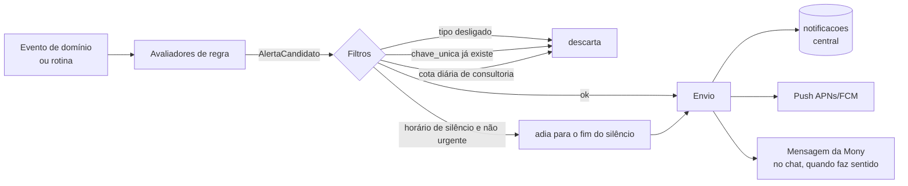

# 09 — Motor de alertas, notificações e rotinas

## Como o motor funciona

O módulo `alertas` avalia regras em dois momentos (do PDF):

1. **Após eventos**: transação criada/editada, sincronização de Open Finance, abertura de app de compra, fatura paga.
2. **Em rotinas agendadas** (BullMQ job schedulers no processo `worker`).

Cada avaliador é uma classe com `tipo`, `avaliar(contexto) → AlertaCandidato[]`. O candidato traz `chaveUnica`, `urgente`, `titulo`, `corpo`, `linkInterno`, `acoes` e `vaiParaChat` (com `textoChat` opcional).

**Chat (T-083):** o candidato com `vaiParaChat` que passa nos filtros (não desligado, sem cota estourada, chave nova) vira também uma mensagem da Mony na conversa, pela porta `ChatDosAlertas` (implementada na Mony, `ChatDaMony`): `textoChat`, ou o título e o corpo. Entra na hora, mesmo no silêncio, porque não toca o aparelho; o push continua esperando o fim do silêncio. Falha no chat vai ao log e não segura a notificação.

**Como está (T-082):** os avaliadores dos alertas de dinheiro ficam em `modulos/alertas` (`AvaliadoresAlertas`), só no worker, e chamam `MotorAlertas.emitir`. As regras puras e os links internos estão em `@mony/shared/alertas`.

- **Por evento:**
  - `transacao.registrada` e `transacao.alterada` (despesa normal): `limite_cartao`, `orcamento` (só se a data é do mês de hoje) e `gasto_fora_padrao` (só lançamento dos últimos 7 dias). `transacao.alterada` sai do `PATCH` que muda tipo, valor, data, categoria, forma ou cartão;
  - `parcelamento.registrado`: `limite_cartao` e `orcamento` do mês;
  - `fatura.fechada` e `fatura.atrasada`: o alerta do tipo, se ainda há saldo a pagar.
- **Rotina `alertas-diarios`** (de hora em hora, no minuto 5): avalia os usuários ativos em cujo fuso são 09:00; `fatura_vencimento`, `vencimento_pendente`, `projecao_mes` e, na segunda e no dia 1, `resumo_periodo` (T-083). Um erro num usuário fica no log e não para os outros.
- **Resumos (T-083):** na segunda, a semana anterior (segunda a domingo) contra a de antes; no dia 1, o mês anterior contra o de antes, com os orçamentos que passaram do limite. Despesas, receitas, a diferença das despesas, as 3 categorias com mais despesa (`RelatoriosService.categorias`, sem pagamento de fatura nem transferência). O push é curto; o chat recebe o resumo em linhas. Link `mony://mony`. Chave `resumo:semana:<segunda>` ou `resumo:mes:<AAAA-MM>`. Sem despesa nem receita no período, sem resumo.
- **Faixa:** sai só a maior faixa atingida (de 40% para 85% avisa 80%, não 50%). O ciclo do limite é a competência da fatura aberta hoje (`limite:<cartão>:<AAAA-MM>:<faixa>`), que é uma fatura por cartão.
- **Vencimento:** o aviso "antes" sai no primeiro dia em que faltam de 1 a X dias (X da preferência, padrão 3) e o "no dia" no vencimento; as chaves são `…:<X>` e `…:0`. Assim o que foi lançado já dentro do prazo também é avisado, e a rotina que falhou um dia avisa no seguinte.
- **Lançamentos em lote (Mony) e ocorrências de recorrência** não publicam evento: entram nos avisos de vencimento, mas não nos de limite e orçamento até a próxima despesa avaliada.

## Tipos de alerta

| Tipo (`tipo_alerta`) | Gatilho | Chave única (exemplo) | Urgente | Chat |
|---|---|---|---|---|
| `limite_cartao` | Transação no cartão cruza faixa | `limite:<cartao>:<competência da fatura aberta>:<faixa>` | não | sim |
| `fatura_fechada` | Rotina: data de fechamento | `fatura_fechada:<fatura>` | não | sim |
| `fatura_vencimento` | X dias antes e no dia | `fatura_venc:<fatura>:<dias>` | não | não |
| `fatura_atrasada` | Vencimento passou sem pagamento, ação [Paguei] | `fatura_atrasada:<fatura>` | sim | sim |
| `orcamento` | Gasto cruza 80% e 100% | `orcamento:<categoria>:<competencia>:<faixa>` | não | sim |
| `gasto_fora_padrao` | RN-106 | `fora_padrao:<transacao>` | não | sim (consultoria) |
| `projecao_mes` | RN-107 | `projecao:<ano-semana>` | não | sim (consultoria) |
| `vencimento_pendente` | Parcela/conta X dias antes | `venc:<parcela ou transacao>:<dias>` | não | não |
| `app_compra` | Evento do aparelho | `app:<app>:<data>` | não | não |
| `lembrete` | Data/hora, ações [Feito] [Adiar] | `lembrete:<id>:<ocorrencia>` | sim (ignora silêncio) | não |
| `compromisso` | Antecedência do usuário | `compromisso:<id>` | sim | não |
| `resumo_periodo` | Segunda e dia 1 | `resumo:<semana ou mes>` | não | sim |
| `open_finance` | Consentimento perto de vencer ou erro | `of:<conexao>:<motivo>:<data>` | não | sim |
| `assinatura` | Pagamento recusado, renovação, cancelamento; teste no 2º dia, no último e no fim (T-101, não urgentes) | `assinatura:<evento_id>`; `assinatura:teste:<segundo-dia, ultimo-dia ou fim>` | sim (os do teste, não) | sim |
| `novidade` | Publicação no admin (push opcional; abre a aba Novidades) | `novidade:<id>` | não | não |

Regras de envio: RN-100 a RN-108 em [07](07-regras-de-negocio.md#alertas-e-notificações). Tipos de consultoria (`gasto_fora_padrao`, `projecao_mes`, dicas) contam para o limite diário (3 por padrão; o painel muda, seção Configurações, T-141g). Os parâmetros do `gasto_fora_padrao` (múltiplo, mínimo de lançamentos e valor mínimo) também vêm do painel. `assinatura` não pode ser desligado.

## Envio de push

- `PushProvider` com implementação inicial pelo **Expo Push Service** (aceita tokens Expo e entrega via FCM/APNs, com recibos). Alternativa já prevista: envio direto por FCM HTTP v1 e APNs, se o cliente preferir não depender do Expo **(decisão técnica, troca transparente pela interface)**.
- Tokens inválidos devolvidos nos recibos desativam o `dispositivo`.
- O app grava o token em `POST /v1/me/dispositivos` (T-033). Um token pertence a um aparelho só: registrar num usuário tira de outro, e sair (do aparelho ou de todos) apaga o token.
- Payload sempre com `linkInterno` e `categoria` (para os botões de ação).
- **Como está (T-081):**
  - O motor chama `EnvioPush`, que põe o envio na fila `notificacoes` com id único (`push-<notificação>-<quantidade>`). O worker (`ProcessadorNotificacoes`) manda uma mensagem para cada aparelho ativo do usuário com token, com 5 tentativas.
  - Mensagem de uma notificação: título e corpo dela; `dados` com `linkInterno`, `notificacaoId` e `tipo`; categoria de ação pelo tipo (`CATEGORIAS_ACAO` em `@mony/shared/notificacoes`: `fatura_atrasada` e `lembrete`); canal do Android pelo tipo (`canalDoPush`: `lembretes`, `novidades` ou `alertas`, os canais do doc 04). Título até 120 caracteres e corpo até 900, para caber nos 4 KiB do push.
  - Envio agrupado (fim do silêncio com mais de 3): "Você tem N alertas", com os títulos no corpo e `linkInterno` `mony://notificacoes` (a central), sem categoria, no canal `alertas`.
  - `DeviceNotRegistered` no ticket tira o token na hora; os tickets aceitos voltam à fila para conferir os recibos 15 minutos depois (o Expo guarda por 24 h), e o mesmo erro no recibo tira o token. Tirar o token é `token_push = null` e `ativo = false`, só se o token ainda for o mesmo (o aparelho pode ter registrado outro). O app registra de novo ao abrir, e o registro volta `ativo = true`.
  - Resposta 4xx do Expo (menos 429) vai direto para as falhas; 429, 5xx e falha de rede tentam de novo.
  - O job leva título e corpo: fica no Redis uma hora depois de enviado (para segurar o envio repetido) e um dia se falhar.
- Push silencioso (`content-available`) para o app reagendar alarmes locais quando um lembrete com canal alarme muda. **Como está (T-084a):** job `sincronizar-alarmes` na fila `notificacoes` (id por usuário, 5 s de espera, para juntar mudanças seguidas); o worker manda a cada aparelho com token uma mensagem só com `dados.tipo = sincronizar_alarmes` (`PUSH_SINCRONIZAR_ALARMES`), sem título, corpo nem som. No app, com o app aberto, o ouvinte busca os alarmes de novo (T-088); com o app fechado, a tarefa de segundo plano faz o mesmo com o token de segundo plano do aparelho (T-088b, doc 04).

## Canais de lembrete (do PDF)

| Canal | Como |
|---|---|
| Notificação | Push enviado pelo worker na rotina por minuto |
| Alarme | Agendado **no aparelho** pelo módulo `mony-alarm`, toca sem internet. O servidor é a fonte da verdade; o app sincroniza a agenda de alarmes ao abrir, ao receber push silencioso e ao criar/editar, mandando a lista inteira dos próximos (o aparelho fica com os 50 mais próximos; `GET /lembretes/alarmes`, T-084a; no app, ao abrir e depois de cada mudança, T-084b). Lembrete só com alarme não manda push no Android (o aparelho toca); no iPhone, até a T-023b, manda. [Adiar] cria um alarme só no aparelho, 10 min depois. No Android, sem a liberação do alarme exato, o alarme pode atrasar ([T-023a](../agentes/poc/T-023a.md)) |
| Ligação | Worker chama `VozProvider` (ex.: Twilio) com texto sintetizado. Só plano pago, telefone verificado, dentro do limite mensal (RN-078). Registro em `ligacoes` |

## Rotinas agendadas

Todas no processo `worker`, com chave de job idempotente e processamento em lotes por usuário. Uma rotina é um método com `@Rotina({ nome, padrao })` (`core/rotinas`): o worker acha os métodos na subida, cria um agendador do BullMQ na fila `rotinas` (cron no fuso de São Paulo) e chama o método com o instante do `Clock`. O módulo da rotina entra no `WorkerModule`. As rotinas "diárias" rodam por fuso: o agendador dispara de hora em hora e processa os usuários cujo horário local bateu **(decisão técnica; com um único fuso no início, roda uma vez às 06:00 de São Paulo)**.

| Rotina | Frequência | O que faz |
|---|---|---|
| Gerar transações recorrentes | De hora em hora, no minuto 30 | Materializa ocorrências dos próximos 35 dias (RN-043), no fuso de cada usuário. Implementada na T-038 |
| Fechar faturas e atrasar (`atualizar-faturas`) | De hora em hora, no minuto 45 | No fuso de cada usuário, a fatura que fechou ganha o status do dia (`fechada`, `parcial`, `paga` ou `atrasada`) e publica `fatura.fechada` se tem valor; a que venceu sem o total pago vira `atrasada` e publica `fatura.atrasada`. Implementada na T-047 |
| Marcar atrasos (`marcar-atrasos`) | De hora em hora, no minuto 0 | Parcelas pendentes vencidas → `atrasado`; o status guardado dos parcelamentos tocados e dos que estavam atrasados é refeito. Parcela de dívida publica `parcela.atrasada`. Implementada na T-047 |
| Encerrar testes (`encerrar-testes`) | Diária 01:15 | Testes vencidos → gratuito (RN-126). Os avisos do 2º dia, do último e do fim (RN-124) saem na `alertas-diarios`, às 09:00 de cada pessoa. Implementada na T-101 |
| Push das novidades (`enviar-push-novidades`) | A cada minuto | A novidade publicada com push que entrou no ar e ainda vale vai a todas as contas ativas pelo motor (tipo `novidade`), em lotes de 500; grava `push_enviado_em`. Implementada na T-141d |
| Alertas técnicos (`monitorar`) | A cada 5 minutos | Fila parada, falhas nas filas de webhook e custo de IA do dia acima do limite: log `alerta_tecnico` e e-mail para o responsável técnico (doc 12). Implementada na T-142a |
| Excluir contas (`excluir-contas`) | De hora em hora, no minuto 20 | As exclusões pedidas há 7 dias (RN-161) vão para a fila `privacidade` (job `excluir-conta`): cancela a assinatura na hora, apaga os arquivos do S3 e os dados, e anonimiza a linha de `usuarios`. Implementada na T-140b |
| Métricas do painel (`atualizar-metricas`) | De hora em hora, no minuto 50 | Recalcula as *materialized views* de usuários ativos, lançamentos por origem e alertas (`REFRESH … CONCURRENTLY`). Implementada na T-141f |
| Alertas de vencimento e projeção (`alertas-diarios`) | De hora em hora, no minuto 5, para quem está às 09:00 | `fatura_vencimento`, `vencimento_pendente`, `projecao_mes`. Implementada na T-082 |
| Resumo semanal e mensal | Segunda e dia 1, 09:00 (na `alertas-diarios`) | Mensagem da Mony no chat + push. Implementada na T-083 |
| Repetir orçamentos | Dia 1, 00:15 | Copia do mês anterior os orçamentos com `repetir_mensal` (RN-060); o mês é o de São Paulo (T-043) |
| Sincronização Open Finance | A cada 6 h | Além dos webhooks |
| Aviso de consentimento | Diária | 7 dias antes de vencer (RN-144) |
| Disparo de lembretes e ligações (`disparar-lembretes`) | A cada minuto | Lembretes com `data_hora` (ou `adiado_ate`) vencidos e ainda não tocados: push urgente com [Feito] [Adiar], também para quem aceitou o convite do lembrete (T-124c); a repetição passa para a próxima ocorrência. Implementada na T-084a (doc 05, "Lembretes"); as ligações, na T-122 |
| Sincronização de agendas externas | A cada 15 min | Google e Microsoft (prefira webhooks/delta quando disponíveis) |
| Liberação do silêncio (`liberar-silencio`) | A cada 15 min | Envia alertas adiados cujo silêncio terminou; mais de 3 para o mesmo usuário saem num envio agrupado. Implementada na T-080 |
| Limpeza | Diária 03:00 | Rascunhos, códigos, sessões expiradas; arquivos fora do prazo de retenção (RN-162). Os rascunhos da Mony já saem na `limpar-rascunhos` (T-061, RN-088) |
| Retenção de arquivos (`limpar-arquivos`) | Diária 03:30 | Apaga do S3 as fotos, documentos e áudios enviados há mais dias que o prazo do painel (padrão 90, RN-162) e tira a linha de `anexos`; o lançamento fica. Implementada na T-140c |
| Backup check | Diária | Confere que o snapshot do banco existe (alerta se não) |

## Central de notificações

`GET /notificacoes` com filtro por tipo, paginação por cursor. `POST /notificacoes/:id/lida`. Contador de não lidas no `GET /dashboard` (`notificacoesNaoLidas`; o das novidades em `novidadesNaoLidas`, e o sino soma os dois). Novidades vêm de `GET /novidades` (as no ar: publicadas, que já entraram e ainda valem, até 50, com `lida` de cada uma e `naoLidas`) e aparecem na mesma central em aba própria (T-150); `POST /novidades/:id/lida` responde 204, ou 404 se a novidade não está no ar. As publicadas antes de a conta existir chegam lidas e não contam.

No app (T-087): a central abre pelo sino do Início, com "Todas | Não lidas", marcar como lida ao tocar (e abrir a tela do link) e "Marcar todas como lidas"; as preferências e o silêncio ficam em Perfil → Alertas da Mony ([04](04-app-mobile.md)).
