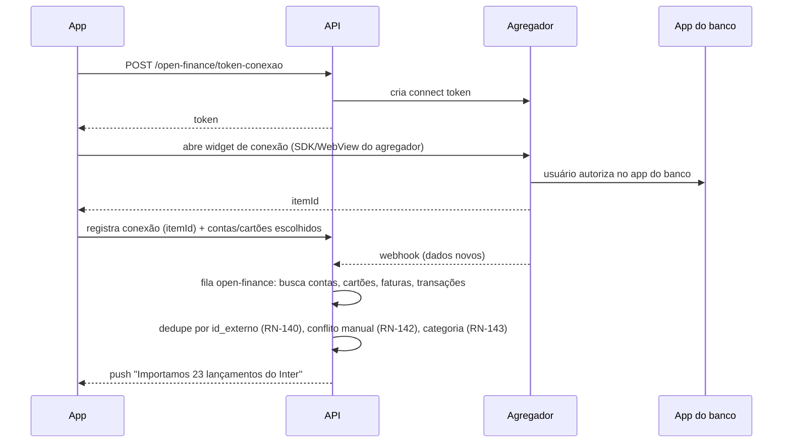

# 10 — Integrações externas

Regra geral (do PDF): cada integração fica num módulo isolado em `apps/api/src/integracoes/<nome>`, atrás de uma interface, com credenciais no cofre de segredos e nunca no app. Toda integração tem implementação **fake** para desenvolvimento e testes.

| Integração | Interface | Fornecedor inicial | Ambiente de homologação |
|---|---|---|---|
| Open Finance | `OpenFinanceProvider` | Pluggy, Belvo ou Klavi (cotar) | Sandbox do agregador |
| Pagamentos | `BillingProvider` | Stripe | Stripe test mode |
| Agenda | `CalendarProvider` | Google Calendar API, Microsoft Graph; no aparelho EventKit/CalendarContract via `expo-calendar` | Contas de teste |
| Apps de compra | módulo nativo `mony-app-usage` | Screen Time (iOS), UsageStatsManager (Android) | Aparelhos reais |
| NFC-e | `NfceProvider` | API de terceiros que padronize as Sefaz (avaliar) ou leitor próprio por UF | Cupons reais de teste |
| IA | `LlmProvider`, `TranscricaoProvider` | Ver [08](08-mony-agente-ia.md#provedor-de-ia). `IA_PROVEDOR`: `anthropic` (Messages API em streaming, `ANTHROPIC_CHAVE_API`, `IA_MODELO`) ou `fake` (PoC T-020). `TRANSCRICAO_PROVEDOR`: `deepgram` (pre-recorded por URL, `DEEPGRAM_CHAVE_API`, `TRANSCRICAO_MODELO`, padrão `nova-3`) ou `fake` (T-064) | Mesmo provedor, chave separada |
| Push | `PushProvider` | Expo Push (FCM/APNs) | Builds de teste |
| Voz | `VozProvider` | Twilio (ou equivalente) | Números de teste |
| E-mail | `EmailProvider` | Brevo (já usado hoje) | Conta de teste |

## Open Finance

**Fora do lançamento (T-158):** o cliente tirou o Open Finance do lançamento em 30/10/2026 para cortar custos (o agregador custa a partir de R$ 2.500 por mês). Ele volta quando o sistema já estiver rendendo; as tarefas estão em "Futuro" no BACKLOG, e o modelo de dados fica pronto e sem uso.

Fluxo (do PDF):

- Widget do agregador: usar o SDK React Native oficial do agregador escolhido se existir, senão `react-native-webview` com a URL de conexão. **Verificar na PoC** se o redirecionamento para o app do banco e a volta funcionam no Expo (deep link de retorno).
- `conexoes_open_finance.status`: `ativa`, `atualizando`, `erro_login`, `consentimento_expirado`, `desconectada`.
- Desconectar: revoga no agregador, mantém os lançamentos importados (o usuário pode apagá-los) **(decisão técnica)**.
- Custo: o PDF cita Pluggy a partir de R$ 2.500/mês com excedente por uso. Recurso exclusivo de plano pago (RN-121). Cotar Belvo e Klavi **(pendência do cliente)**.

## Stripe

- **Produtos/preços:** um produto "Monitorizze" com `Price` mensal e anual. Mudança de valor pelo admin cria novo `Price` e marca como vigente (RN-129).
- **Checkout:** `POST /assinatura/checkout` cria a sessão. Duas formas, decididas por plataforma e regras de loja vigentes:
  - Página externa (Stripe Checkout) aberta com `expo-web-browser`, retorno por deep link. Funciona nas duas plataformas.
  - Dentro do app com PaymentSheet (`@stripe/stripe-react-native`), onde a loja permitir processador próprio.
- **Pix em assinatura recorrente:** **não funciona na Stripe (testado em 15/10/2026, conta BR de teste do dono, PR #92).** Com o Pix ligado no painel, o checkout de assinatura só oferece cartão. Pedindo `pix` explicitamente, a Stripe cria a sessão, mas recusa o pagamento: "`setup_future_usage` cannot be used with […] `pix`" (o Pix não fica salvo para as próximas cobranças). A assinatura com fatura enviada (`collection_method=send_invoice`) também recusa o Pix ("The payment method type `pix` is invalid"). O Pix só passa em pagamento único (`mode=payment`). Alternativas: (a) Pix só no plano anual, como pagamento único que libera 12 meses; (b) faturas mensais da Stripe com Pix como forma de pagamento enviadas por e-mail/push **(confirmar com cliente)**.
- **Webhooks tratados:** `checkout.session.completed`, `checkout.session.async_payment_succeeded` (Pix, T-105), `customer.subscription.created|updated|deleted`, `invoice.paid`, `invoice.payment_failed`, `invoice.upcoming`. Atualizam `assinaturas` e disparam alertas `assinatura`.
- **Portal do cliente** para trocar plano, cartão e cancelar (`POST /assinatura/portal`).
- **Regras das lojas no Brasil:** o PDF registra que o iOS (desde 26.5) permite processador próprio ou link externo com comissão da Apple, e que o Android permite link externo, com faturamento alternativo previsto para 2027. **Revalidar as regras e taxas antes de publicar.** A interface `BillingProvider` já prevê "loja" como origem alternativa do status, sem implementação inicial.

- **Como está (T-102):** `integracoes/cobranca`, com o `CobrancaProvider` em duas versões, escolhidas por `COBRANCA_PROVEDOR`:
  - `stripe` exige `STRIPE_CHAVE_SECRETA` e `STRIPE_SEGREDO_WEBHOOK`. Usa a versão da API fixada pelo pacote `stripe`.
  - `fake` não cobra ninguém e é o padrão. O checkout devolve o próprio retorno de sucesso. Em produção, responde 503 a tudo, inclusive ao webhook.
- **Formas de pagamento:** são as ligadas no painel da conta; o código não passa uma lista. Na assinatura, isso dá só cartão (e carteiras como Apple Pay), pelo motivo acima.
- **Pix no anual (T-105, alternativa (a), a resposta sugerida à pergunta 9 do cliente, **(confirmar com cliente)**):** `POST /assinatura/checkout { plano: 'anual', forma: 'pix' }` cria um Checkout `mode=payment` com `allowed_payment_method_types: ['pix']` (o Pix precisa estar ligado no painel), o valor do anual vigente e `metadata.tipo=anual_pix` com o `planoPrecoId`; os cupons (RN-130) valem. O Pix confirma depois: o pagamento chega em `checkout.session.async_payment_succeeded` (ou no `checkout.session.completed` já com `payment_status=paid`) e vira o evento `pagamento_unico`, que libera o anual na hora (RN-128) até `assinaturas.pago_ate` = agora + 12 meses, sem assinatura na Stripe. Pagar de novo antes do fim soma 12 meses ao fim; o mesmo checkout não soma duas vezes (`pagamento_unico_id`). Não renova sozinho: 7 dias antes do fim e no fim sai um alerta `assinatura`, e a rotina `encerrar-pix-vencidos` grava a volta ao gratuito (antes dela, `planoEfetivo` já trata o vencido como gratuito). No cartão, quem está no Pix só assina depois do fim. Um Pix pago por quem já assina no cartão (dois pagamentos ao mesmo tempo) não muda nada e fica no log de erro, para o suporte devolver.
- **Retorno ao app:** a Stripe só aceita endereço `https` no `success_url`. Por isso, o checkout e o portal voltam para `GET {API_URL_PUBLICA}/v1/assinatura/retorno?resultado=sucesso|cancelado|portal`, que redireciona (302) para `mony://planos?checkout=<resultado>`. O app abre a página com `WebBrowser.openAuthSessionAsync`, que fecha ao ver o `mony://`, e consulta `GET /assinatura` (RN-128).
- **Cliente:** um cliente na Stripe por pessoa, criado no primeiro checkout (`assinaturas.stripe_customer_id`), com chave de idempotência `cliente-<usuarioId>`. Quem já tem plano pago troca de plano pelo portal; o checkout responde `ASSINATURA_JA_ATIVA`.
- **Webhook (`POST /v1/webhooks/stripe`):**
  - Confere o `Stripe-Signature` sobre o corpo bruto (`request.rawBody`, guardado pelo adaptador Fastify) e traduz o evento (`traducao-stripe.ts`).
  - Grava em `webhook_eventos` uma vez só (`provedor` + `id_externo`), põe na fila `webhooks` e responde 200. Os eventos que o Mony não usa não são gravados.
  - O worker (`ProcessadorWebhooks`) não confia na ordem dos eventos: lê a assinatura atual na Stripe e grava a situação dela.
- **Situação na Stripe → Mony:**
  - `active` e `trialing`: plano do preço, `ativa`.
  - `past_due`: `inadimplente`, ainda pago (RN-131).
  - `canceled`, `unpaid`, `incomplete_expired` e `paused`: gratuito, `cancelada`. Só vale se for a assinatura gravada, para o fim de uma antiga não derrubar a nova.
  - `incomplete`: nada muda.
  - O plano vem de `planos_precos.stripe_price_id`; se o preço não estiver lá, vem do intervalo da cobrança (mês ou ano).
- **Avisos (tipo `assinatura`, urgentes, com chat, chave `assinatura:<evento>`):**
  - cobrança recusada (`invoice.payment_failed`), com a data da próxima tentativa;
  - renovação (`invoice.upcoming`), só para assinatura ativa sem cancelamento;
  - fim da assinatura.
- **Cupons (RN-130, T-104d):** cada cupom do painel é um cupom da Stripe (`percent_off`, `duration: once`: o desconto vale na primeira cobrança; no anual, no primeiro ano) e um código promocional com o código do painel. O checkout já tem `allow_promotion_codes`, então a pessoa digita o código em "Adicionar código promocional". A validade vai como `redeem_by` e `expires_at` (o fim do último dia, em São Paulo). Desativar apaga o cupom na Stripe: o código para de valer e quem já usou fica com o desconto. As chamadas usam chave de idempotência com o id do cupom no Mony. **Ainda não testado na conta de teste** (só com a cobrança falsa).
- **Configurar a conta:** `pnpm --filter api build && pnpm --filter api cobranca:configurar --mensal <centavos> --anual <centavos> [--webhook <url>]`, com `STRIPE_CHAVE_SECRETA` e `DATABASE_URL` no ambiente. O script (`src/configurar-stripe.ts`):
  - Cria ou reaproveita o produto "Monitorizze" e os preços em BRL (`lookup_key` `mony_mensal` e `mony_anual`). Um valor novo cria outro preço (RN-129).
  - Grava os preços em `planos_precos`.
  - Configura o portal: trocar entre mensal e anual com proporcional, cartão, notas e cancelar no fim do período.
  - Com `--webhook`, cria o endpoint com os eventos tratados e mostra o segredo uma vez.
  - **Na conta:** em Configurações → Cobrança → Assinaturas, deixar "cancelar a assinatura" quando as tentativas acabarem (RN-131).

## Login social

Google e Apple (RN-002). O app usa os SDKs do doc 02 e manda o `id_token` à API, que confere tudo no servidor (`integracoes/login-social`, T-032):

- **Assinatura** pelas chaves públicas do provedor: `https://www.googleapis.com/oauth2/v3/certs` e `https://appleid.apple.com/auth/keys`. As chaves ficam em cache e são buscadas de novo quando aparece um `kid` desconhecido. Só RS256.
- **Emissor, audiência e validade.** A audiência vem de `GOOGLE_CLIENT_IDS` (IDs de cliente iOS, Android e web) e de `APPLE_CLIENT_IDS` (bundle id e, se houver login pela web, o Services ID). A lista vazia desliga o provedor. A tolerância de relógio é de 60 s.
- **Nonce.** O app gera um valor aleatório por login. A Apple recebe o SHA-256 dele e o devolve no token; a API confere contra o valor que o app manda. Com a Apple é obrigatório; com o Google, vale quando o token traz o nonce.
- **Uso único.** O resumo do token fica marcado no Redis até ele vencer, contra repetição.
- **Sem segredo no servidor:** os IDs de cliente são públicos. O que pede conta do cliente é criar os clientes OAuth no Google Cloud e ativar o Sign in with Apple no App ID.

## Agenda

- **Google e Outlook:** OAuth no servidor (`POST /agendas/conectar` devolve URL de consentimento; callback grava tokens criptografados). Escopos mínimos de leitura/escrita de eventos. O Google exige **verificação do app** para escopos de agenda ao público: iniciar o processo cedo (Fase 0/1), porque leva semanas.
- **Agenda do aparelho (iPhone/Android):** `expo-calendar` no app, com permissão. Leitura local; o app envia ao servidor apenas os compromissos do período para exibir junto **(decisão técnica: ou não envia nada e mescla só na tela; escolher na Fase 1 pensando em LGPD)**.
- Compromisso criado pela Mony vai para a agenda padrão. Se a padrão for a do aparelho, o servidor cria o compromisso e o app grava localmente na próxima sincronização (push silencioso).
- **Como está (T-085a):** `CalendarProvider` (`integracoes/agenda`) com um falso por provedor (`ProvedoresAgenda`), que guarda os eventos na memória e devolve o consentimento direto para o callback. As rotas, a sincronização e a revogação estão no doc 05, "Agenda". Faltam o Microsoft Graph (T-085h), a KMS (T-085i) e a agenda do aparelho (T-085f).
- **Google Calendar (T-085g):** `CalendarGoogle` (`integracoes/agenda/calendar-google.ts`), sem SDK. Consentimento com o escopo `calendar.events` (só os eventos, o mínimo), `access_type=offline` e `prompt=consent`, para o token de renovação vir sempre. Trabalha na agenda principal (`primary`). Lê os eventos com `singleEvents=true` (as repetições vêm abertas) em páginas de 250; os de dia inteiro começam à meia-noite no fuso da agenda; os cancelados ficam de fora. Cria com o fim igual ao início quando o compromisso não tem fim (o Google exige o fim) e lê de volta como "sem fim". Renova o token antes de vencer e uma vez depois de um 401; `invalid_grant` vira `acesso_revogado` (a agenda vai para `reconectar`). Liga com `GOOGLE_OAUTH_ID_CLIENTE` e `GOOGLE_OAUTH_SEGREDO` (o cliente OAuth "Aplicativo da Web" do projeto Monitorizze, com `<API_URL_PUBLICA>/v1/agendas/oauth/callback` autorizado). **Enquanto o app estiver "Em teste" no Google**, só os usuários de teste cadastrados conectam, e o Google vence o token de renovação em 7 dias: a agenda pede para reconectar toda semana. A publicação e a verificação ficam na T-085j.

## Detecção de apps de compra

O app não lê conteúdo de outros apps. Só recebe o aviso de que um app da lista foi usado (do PDF).

**iOS — Screen Time API (FamilyControls, DeviceActivity, ManagedSettings)**
- Exige entitlement `com.apple.developer.family-controls` aprovado pela Apple para distribuição. **Pedir no início do projeto.**
- O usuário escolhe os apps numa tela do sistema (`FamilyActivityPicker`); o app não sabe quais apps são, recebe tokens opacos. Por isso a lista sugerida do PDF é apresentada como orientação, mas a seleção é do usuário no seletor do sistema.
- A extensão `DeviceActivityMonitor` dispara quando um limiar de uso é atingido (ex.: 1 minuto no intervalo), não no instante da abertura.
- A extensão roda com limites fortes de memória e capacidades. **Validar na PoC** se ela consegue chamar o servidor. Plano B já desenhado: a extensão dispara uma **notificação local** usando o orçamento de compras guardado num App Group pelo app (atualizado a cada abertura e push silencioso), e registra o evento para o app enviar ao servidor depois.

**Android — UsageStatsManager** (PoC na [T-022](../agentes/poc/T-022.md), módulo `modules/mony-app-usage`)
- Permissão `PACKAGE_USAGE_STATS`, concedida pelo usuário nas configurações do sistema ("Acesso ao uso"; não há diálogo). O app abre a página do próprio app nessa tela.
- Não há callback de "app aberto". **Decidido na PoC: WorkManager periódico**, a cada 15 min (o mínimo), aceitando o atraso. A verificação lê os eventos `ACTIVITY_RESUMED` e `ACTIVITY_PAUSED` dos apps monitorados desde a anterior (no máximo 24 h para trás) e conta como abertura a volta ao app depois de 30 min sem vê-lo (trocar de tela, apagar a tela e voltar de notificação não contam de novo). Com o aparelho em uso, o atraso esperado é de até ~15 min; parado, o Doze adia a verificação, mas também não há app sendo aberto. O serviço em primeiro plano com `queryEvents` contínuo (preciso, mas com notificação fixa e tipo `specialUse` justificado na Play) fica como plano B, só se a medição no aparelho reprovar o atraso.
- Lista de apps: os que abrem pela tela inicial, visíveis pelo `<queries>` de `MAIN/LAUNCHER` no manifesto do módulo, sem `QUERY_ALL_PACKAGES` (restrita pela Play).
- Play: a política de dados do usuário pede divulgação em destaque e consentimento antes de levar a pessoa à configuração (a tela explicativa do doc 04, "Permissões"), política de privacidade e o formulário de Segurança dos dados. Não achamos formulário de declaração próprio para o acesso ao uso, como existe para SMS ou `QUERY_ALL_PACKAGES`; **confirmar na primeira submissão (T-146)**.
- **Como a abertura chega ao servidor (T-121):** o worker roda sem o JS, e a sessão do app (refresh rotativo, RN-008) não pode ser usada por fora sem risco de dois processos renovarem o mesmo token. Recomendação da PoC: um **token de evento** por aparelho, com escopo só para `POST /eventos/app-compra-aberto`, emitido quando a pessoa liga o recurso, guardado no armazenamento nativo cifrado e revogado ao sair, ao revogar o consentimento ou ao trocar de plano. O worker manda a abertura (com rede; fila local se estiver sem), e o servidor aplica RN-104, monta a mensagem com o orçamento e envia o push no canal `alertas`. A mesma ideia serve à extensão do iOS (T-021).
- **Como está no servidor (T-121a):** `POST /apps-monitorados/token-evento` emite o token (`mte_…`, só o SHA-256 no banco, tabela `tokens_evento`) e `POST /eventos/app-compra-aberto` recebe a abertura com ele (doc 05, "Apps de compra"). A resposta diz se o alerta saiu ou o motivo; com 401 ou 403, o aparelho para de mandar até o app pedir outro token. Abertura com mais de 60 minutos não vira alerta. Falta o aparelho: o worker do Android (T-121b) e a extensão do iOS (T-121c).

Recurso exclusivo de plano pago (RN-121) e com consentimento LGPD separado.

## NFC-e

Avaliação completa na PoC [T-026](../agentes/poc/T-026.md); API na T-066a.

- QR Code do cupom: URL da Sefaz do estado com a chave de acesso no parâmetro `p` (versão 3 desde set/2025; 1 e 2 em cupons antigos). O app lê com `expo-camera` (T-066b) e manda o conteúdo para `POST /v1/mony/nfce`.
- `lerQrNfce` (`@mony/shared/nfce`) extrai e confere a chave sem rede: formato (inclusive CNPJ alfanumérico, desde jul/2026), dígito verificador, UF e modelo 65. O app usa para avisar na hora; a API valida de novo.
- O servidor manda **só a chave** ao `NfceProvider` e nunca acessa a URL do QR Code, então não há risco de SSRF. Um leitor próprio por UF, se um dia existir, valida o domínio contra a lista de cada Sefaz.
- **`NfceProvider`** (`integracoes/nfce`), escolhido por `NFCE_PROVEDOR`: `fake` (padrão: um mercado de exemplo para toda chave) e `infosimples` ("SEFAZ / NFC-e Unificada", 26 UFs; conferir o DF), com `INFOSIMPLES_TOKEN`. Erros em três motivos: `nao_encontrada` (a Sefaz ainda não tem a nota), `indisponivel` (falha que passa) e `recusada` (não adianta repetir). O envelope e os códigos da Infosimples seguem o padrão da API v2 deles e **precisam ser conferidos com a conta de teste e cupons reais** (BLOQUEIOS).
- **Fluxo (`NfceMony`):**
  - QR que não é cupom, ilegível ou de homologação (teste do estabelecimento) → aviso, sem consulta e sem cota.
  - A mesma chave nunca é consultada duas vezes (`nfce_notas` única por usuário): ler de novo mostra o mesmo cartão, ou avisa que a compra já foi lançada.
  - A consulta conta como `leitura_documento` no gratuito (RN-120).
  - Nota encontrada → `nfce_notas` e `nfce_itens` gravados, e a compra (o nome da loja sem o sufixo jurídico, o total pago, a data no fuso do usuário e a forma de pagamento do cupom) vira cartão a confirmar, como a foto (RN-083; a mesma compra pode já ter sido lançada à mão). Categoria, forma e cartão faltantes vêm das preferências do estabelecimento (RN-090) ou viram perguntas (RN-080). Gravar liga a nota à transação (`nfce_notas.transacao_id` e `transacoes.nfce_nota_id`).
  - Nota ainda fora da Sefaz (contingência ou emissão recente) ou consulta fora do ar → novas tentativas na fila `mony-midia` em 5 min, 1 h e 6 h. A nota encontrada vira mensagem da Mony no chat com o [Ver a compra]; esgotadas as tentativas, a Mony pede a foto.
  - Cupom cancelado → aviso. Recusa da consulta (UF sem cobertura, por exemplo) → a Mony pede a foto do cupom (leitura por visão, T-065).
- Os itens alimentam o histórico de preços (RN-150, T-066c) e o preço estimado das listas (RN-071, T-123a).

## Ligação de voz

Servidor agenda, o provedor liga para o número verificado e fala o texto do lembrete com voz sintética em pt-BR. Webhook de status grava resultado e custo em `ligacoes`. Limitado por plano e por mês (RN-078).

Como está (T-122a):

- **`VozProvider`** (`integracoes/voz`): `ligar(para, texto)` devolve o id e a situação inicial da ligação; `enviarSms(para, texto)` manda o código de verificação do telefone. Números em E.164. `ErroVoz` diz se a falha é permanente (número recusado) ou dá para repetir.
- **Só o falso por enquanto** (`VozFake`): guarda o que foi pedido e, fora de produção, escreve no log do worker e da API, inclusive o código do SMS, para testar o app sem provedor. Em produção fica indisponível: a verificação do telefone responde 503 e o lembrete com ligação toca por push.
- **Falta (T-122c):** escolher o provedor (Twilio ou Zenvia, por exemplo), a conta e a chave, o webhook de status (`ligacoes.status`, `custo_centavos`) e o limite mensal confirmado pelo cliente.

## Push

Expo Push via `PushProvider` (doc 09, "Envio de push"). Como está (T-081):

- **Provedores** (`PUSH_PROVEDOR`): `expo` (nuvem) e `fake` (padrão; não envia e, fora de produção, escreve o título no log do worker). Com `EXPO_ACCESS_TOKEN`, o envio leva o token de acesso, que passa a ser obrigatório quando a segurança de push é ligada no projeto do EAS.
- **Lotes:** até 100 mensagens por chamada a `/push/send` e até 1000 ids por consulta de recibos (`/push/getReceipts`), com tempo limite de 15 s.
- **Credenciais das lojas:** a chave do FCM (Android) e a do APNs (iOS) ficam no projeto do EAS, não na API (T-010).
- **Troca:** o envio direto por FCM HTTP v1 e APNs, se o cliente preferir não depender do Expo, entra como outra implementação do `PushProvider`, sem mexer no motor nem na fila.

## E-mail transacional

Brevo via `EmailProvider`, com templates versionados: código de recuperação, boas-vindas, recibos/assinatura, link de exportação de dados, confirmação de exclusão de conta.

Como está (T-031):

- **Modelos no Git** (`apps/api/src/integracoes/email/modelos/`): cada um é uma função que devolve assunto, HTML (tabela com estilos inline) e texto. O Brevo recebe o conteúdo pronto pela API `POST /v3/smtp/email`, com o nome do modelo como etiqueta. Os templates do painel do Brevo não são usados, para o texto mudar junto com o código e passar por revisão.
- **Fila `emails`:** a API só enfileira (`EnvioEmails`); o worker envia (`ProcessadorEmails`), com 5 tentativas e espera exponencial. Resposta 4xx do Brevo (endereço ou chave recusados) vai direto para as falhas, sem repetir. O job sai do Redis assim que o envio dá certo, porque leva o conteúdo (o código de recuperação, por exemplo); um job que falhou fica um dia para investigação.
- **Provedores** (`EMAIL_PROVEDOR`): `brevo` (nuvem, com `BREVO_CHAVE_API` e `EMAIL_REMETENTE` de domínio verificado no Brevo, com SPF e DKIM), `smtp` (desenvolvimento, apontando para o Mailpit do `docker compose`) e `fake` (testes; não envia e, fora de produção, escreve o e-mail no log do worker).
- **Modelos prontos:** código de recuperação (RN-003).
