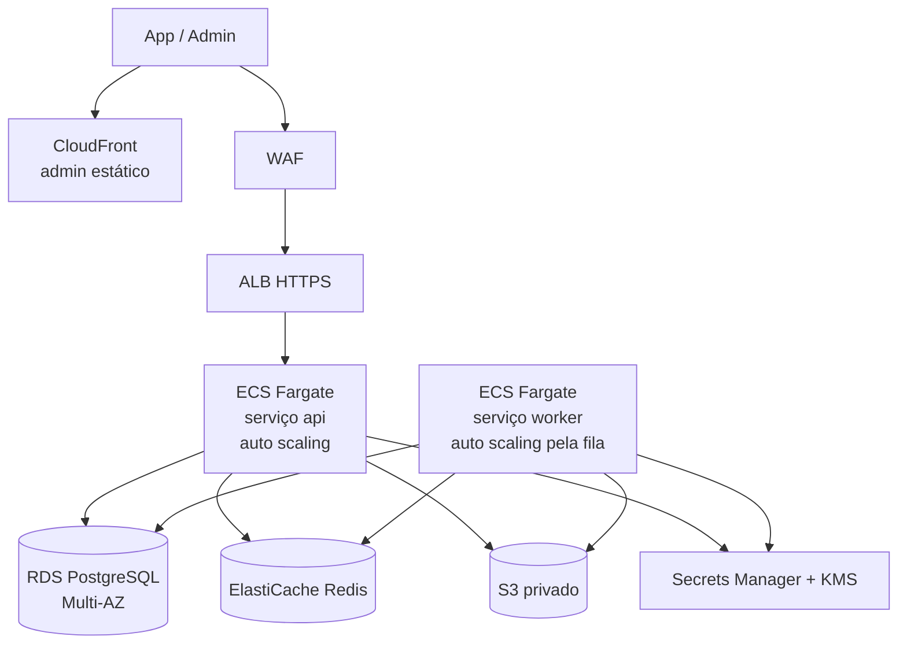

# 12 — Infraestrutura, CI/CD e monitoramento

## Ambientes (do PDF)

| Ambiente | Uso | Banco e chaves | Integrações |
|---|---|---|---|
| `dev` | Desenvolvimento local e previews | Postgres e Redis em Docker Compose; chaves de teste | Fakes ou sandboxes |
| `staging` (homologação) | Testes do cliente, TestFlight e teste interno do Play | Próprios | Stripe test mode, sandbox do agregador |
| `production` | Usuários | Próprios | Reais |

Cada ambiente tem conta AWS (ou ao menos VPC e segredos) separada **(decisão técnica: contas separadas via AWS Organizations)**.

## AWS `sa-east-1` (São Paulo)



| Peça | Serviço | Observação |
|---|---|---|
| API | ECS Fargate, serviço `api` | Auto scaling por CPU e latência; mínimo 2 tarefas em produção |
| Worker | ECS Fargate, serviço `worker` | Auto scaling pelo tamanho das filas; mesma imagem, entrypoint `worker.js` |
| Banco | RDS PostgreSQL Multi-AZ | Backups 30 dias, PITR, criptografia KMS |
| Cache/filas | ElastiCache **Valkey 8** (compatível com Redis; cluster mode off, réplica em produção) | `maxmemory-policy noeviction` para o BullMQ. O ElastiCache não tem AOF nas versões atuais: a durabilidade vem da réplica Multi-AZ e do snapshot diário |
| Arquivos | S3 privado + ciclo de vida | Exportações expiram em 7 dias; mídias conforme RN-162 |
| Admin | S3 + CloudFront | Build estático. O CloudFront repassa `/v1/*` para o ALB, então o painel chama a API no próprio domínio, sem CORS (T-015) |
| DNS e certificados | Route 53 + ACM | `api.<dominio>`, `admin.<dominio>`, `app.<dominio>` (universal links). Cada ambiente tem zona própria (staging: subdomínio delegado, ex.: `staging.<dominio>`); o certificado do admin fica na `us-east-1`, exigência do CloudFront. `app.<dominio>` entra com os universal links |
| Infra como código | Terraform em `infra/` | `bootstrap/` (estado e OIDC do GitHub, uma vez por conta), módulo `modulos/ambiente` e uma pasta por ambiente em `ambientes/`, cada uma com o próprio estado. Ver [infra/README.md](../../infra/README.md) |

Alternativa equivalente em Google Cloud (Cloud Run + Cloud SQL + Memorystore + GCS) aceita pelo PDF; o desenho não muda.

## CI/CD (GitHub Actions)

| Gatilho | Jobs |
|---|---|
| PR | `lint`, `typecheck`, testes unitários e de integração (Testcontainers), checagem de migração Prisma, geração do cliente OpenAPI sem diff, avaliação da Mony se `modulos/mony/**` mudou, Kotlin e testes JUnit dos módulos nativos se `modules/**` mudou (`modulos-nativos.yml`, T-022) |
| Merge em `main` | Build da imagem Docker → ECR (tag do commit e tag `staging`) → tarefa avulsa com `prisma migrate deploy && prisma db seed` → deploy dos serviços `api` e `worker` com circuit breaker (`deploy-staging.yml`); build do admin → bucket → invalidação do CloudFront quando o admin muda (`deploy-admin-staging.yml`); EAS Update no canal `staging` quando o app muda (`eas-update-staging.yml`, T-016) |
| Tag `api-vX.Y.Z` | Deploy da API em produção com aprovação manual |
| Tag `mobile-vX.Y.Z` | `eas build --profile production` + `eas submit` (App Store Connect e Play Console) |
| Correção só de JS | `eas update --channel production` (respeitando `runtimeVersion` por fingerprint) |

Migrações: sempre compatíveis com a versão anterior (expandir → migrar → contrair), porque API velha e nova convivem durante o deploy e apps antigos continuam no ar.

## App: EAS

`eas.json` com perfis:

| Perfil | Distribuição | API | Canal de update |
|---|---|---|---|
| `development` | Interna (dev client) | dev/local | — |
| `preview` | Interna (APK / ad hoc) | staging | `staging` |
| `production` | Lojas | produção | `production` |

- TestFlight e teste interno do Play para homologação (do PDF).
- OTA (EAS Update) só para JS/assets, dentro das regras das lojas. Mudança nativa = novo binário.
- Staging: todo merge que mexe no app publica no canal `staging` (`eas update --environment preview`, com as variáveis do ambiente `preview` do EAS). Produção: `eas update --channel production` à mão, para correção só de JS.
- Atualização do SDK do Expo: pelo menos uma vez por ano, em branch própria, com regressão completa.

## Monitoramento (do PDF)

| Item | Ferramenta |
|---|---|
| Erros do app e do servidor | Sentry (projetos `mobile`, `api`, `worker`, `admin`) com releases e source maps |
| Logs centralizados | CloudWatch Logs (JSON do pino) com `requestId`, `usuarioId` (hash) e rota |
| Métricas | Tempo de resposta e falhas por rota, tamanho e falhas de filas (BullMQ → CloudWatch), custo de IA por dia. Ver "Métricas (T-142d)" abaixo |
| Painel de filas | Bull Board protegido no admin |
| Analítica de produto | PostHog: cadastros, conclusão do onboarding, uso da Mony, retenção, conversão |

### Métricas (T-142d)

- **Por rota:** o log de cada requisição da API (pino-http) leva `rota`, o padrão da rota (ex.: `/v1/transacoes/:id`), além de `responseTime` e `res.statusCode`. Tempo de resposta e falhas por rota saem do CloudWatch Logs Insights, nas consultas salvas `mony-<ambiente>/tempo-de-resposta-por-rota` e `mony-<ambiente>/falhas-por-rota`. Uma métrica por rota custaria uns US$ 0,30 por métrica por mês, vezes as rotas; a consulta só cobra quando roda.
- **Filas e custo de IA:** a rotina `monitorar` escreve no log do worker, no Embedded Metric Format, as métricas `Aguardando` e `Falhos` por `Fila` e `CustoIaHojeCentavosDolar` (o custo acumulado do dia em São Paulo: o máximo do dia é o custo do dia), no namespace `Mony/<ambiente>` (`METRICAS_NAMESPACE`). O CloudWatch Logs cria as métricas a partir do log, sem chamada à API.
- **Painel:** o painel `mony-<ambiente>` do CloudWatch (output `painel`) junta tempo de resposta e 5xx do ALB, as filas, o custo de IA por dia e as duas consultas por rota.

### Alertas para o responsável técnico

- API fora do ar (health check do ALB e uptime externo).
- Fila parada ou crescendo sem consumo.
- Falha em webhook da Stripe ou do agregador (taxa de erro ou fila de falhas > 0).
- Custo de IA do dia acima do limite configurado.
- Taxa de erro 5xx acima de 1% por 5 minutos.
- Backup diário não encontrado.

**Pelo worker (T-142a).** A rotina `monitorar` (módulo `monitoramento`, a cada 5 minutos) cuida de três destes alertas:

| Alerta | Quando | Repete |
|---|---|---|
| Fila parada | O job mais antigo da lista `wait` de qualquer fila espera há mais que o limite do painel (15 min por padrão). Pega worker fora do ar e fila crescendo sem consumo | De hora em hora, enquanto continuar |
| Falha em webhook | As filas `webhooks` (Stripe) e `open-finance` (agregador) têm jobs que esgotaram as tentativas | Só quando o número de falhas cresce; zerou, a próxima falha avisa |
| Custo de IA | O custo do dia (São Paulo) pela tabela de preços do painel (T-141e) chega ao limite do painel (US$ 50,00 por padrão; 0 desliga). Modelo sem preço fica fora da conta e é citado no alerta | Uma vez por dia |

- Cada alerta vai para o log como erro com `evento: "alerta_tecnico"` (com `tipo` e `chave`) e por e-mail para `ALERTAS_TECNICOS_EMAILS` (variável `emails_alertas` do Terraform), direto no provedor de e-mail, sem a fila `emails`: se ela for a parada, o aviso ainda sai. Sem destinatário, só o log. Se nenhum e-mail sair, a próxima volta tenta de novo.
- O que já foi avisado fica no Redis (chaves `monitoramento:*`).
- Cada volta escreve `evento: "monitoramento_executado"` no log; um alerta cujo e-mail não saiu escreve `evento: "alerta_tecnico_sem_email"`.

**Pela AWS (T-142b).** `infra/modulos/ambiente/alarmes.tf`, todos no tópico SNS `mony-<ambiente>-alertas`, com e-mail para `emails_alertas` (a mesma lista vai para o worker):

| Alarme | Métrica | Dispara |
|---|---|---|
| API fora do ar | `HealthyHostCount` do grupo de destino do ALB | Nenhuma tarefa saudável por 2 minutos (sem dado também conta) |
| 5xx | `HTTPCode_Target_5XX_Count` + `HTTPCode_ELB_5XX_Count` sobre `RequestCount` | Acima de 1% em 5 minutos, com pelo menos 20 requisições no período |
| Monitoramento parado | Filtro `monitoramento_executado` no log do worker | Nenhuma volta em 15 minutos: worker, fila `rotinas` ou Redis parados |
| Alerta técnico sem e-mail | Filtro `alerta_tecnico_sem_email` no log do worker | Qualquer um em 5 minutos |
| Backup não encontrado | Regra do EventBridge para `RDS-EVENT-0002` (backup automático concluído) → grupo de logs → filtro | Nenhum backup concluído em 24 horas |

- O uptime externo (alguém de fora chamando `/v1/health`) fica para quando houver domínio: o alarme do ALB não pega o DNS ou o próprio ALB fora.

## Ambiente local

```
docker compose up -d --wait   # postgres, redis, seaweedfs (S3), mailpit
pnpm i
pnpm --filter api prisma migrate dev && pnpm --filter api seed
pnpm dev                 # api + worker + admin
pnpm --filter mobile start  # dev client no aparelho/emulador
```
